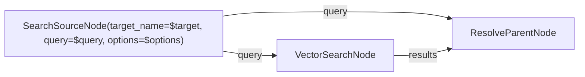

# Suite de la dette469 : deux options, préparation sans écriture

Source produit relue927941a67a5805450d49f1e04b39fdd542a6059b. Le [ticket469](../tickets/2026-11-16-la-migration-de-scopes-laisse-469-morceaux-sans-vecteur-transfere.md) reste ouvert. C7 autorise cette préparation RO seulement, aucun writer/embedding/service ni repriseLIVE. Les anciennes portées sont terminées.

## Ce que les preuves permettent encore de mesurer sans base

Analyse pure `bascule/analyze-moved-vector-candidates.py` sur trois ensembles de preuves entièrement réempreintés : replay121/manifeste6d466..., geometry42/dd5157..., diagnostic55/5447d16.... Aucun fichierDB ouvert, aucun texte ou vecteur chargé. L'égalité469UUID/new-only est revérifiée avec multiplicité.

Parmi469nouveauxseuls, **74ont chacun UN candidat ancien de mêmeparent/hash**, et395n'en ont pas dans ce périmètre. Les74 ont aussi le mêmechamp `content` (filtre explicite des deux requêtes), les mêmes bornes complètes et les mêmes bornes cœur ; **seul le rang diffère**. Zéroambiguïté de candidats dans cette sélection, zéroégalité de rang. Pas de recherche de hash globale à d'autres parents.

Le rejeu a calculé ces hashes sur les mêmes contenus parents et exactement ces bornes : les textes reconstruits par les deux découpeurs sont donc les mêmes pour ces74. Mais les TSV ne transportent pas les colonnes `_text` littérales persistées, les titres, ni les vecteurs ; ils n'excluent pas indépendamment une incohérence texte/hash stockée, une collision de hash, une différence de titre ou des valeurs vectorielles discordantes. Ne pas transformer une absence de donnée en zéro conflit.

Modèle persisté observé : granite-278m, dimensiondéclarée768, storage=suffixed, colonneembedding__granite_278m etmarqueur_embed_hash__granite_278m. Les102002anciensmorceaux ont0dette selon le prédicat vecteurnonNULL etmarqueur==_text_hash, avant ETaprès migration. Cela couvre l'existence et la fraîcheur du marqueur des candidats, pas une relecture de leurs768composantes ni leur identité binaire/provenance du service. Dimension réelle de chaque vecteur, titre, égalité littérale stockée et conflits de vecteurs : **NON OBSERVÉS** dans ces fichiers.

Résultat :74candidats POTENTIELS, **0réutilisation nouvellement qualifiée**, aucune borne «395calculs suffisants» ni «469calculs nécessaires». Preuve locale `vector-debt-moved-candidates-01/` : candidates.json, summary.json, provenance.json ; manifeste3fichiers SHA7efd0727a81c5c2b0d1410d9de2a83079463094564992f422b59d3f09e88d21f. Répertoire sous ~/.cache/rag3weaver-build/bascule-live-20261116.

## OptionA : chemin existant, textes persistés, pas de rescan

Préférence de préparation : conserver produit927/ELF0e310/SDK59ac, et payer la dette par le mécanisme existant plutôt qu'écrire un Rust de réparation.

Chemin réellement relu : `Catalog::embarquer_le_retard`/`embarquer_le_retard_suivi` (catalog.rs4458/4495) → `preparer_l_embarquement` → réclamation bornée par table via`reclamer_le_retard_sauf` → graphe existant`EmbedNode` en modeCompute → `poser_les_vecteurs` → `finir_l_embarquement`. La réclamation lit `_uuid,_text,_text_hash` **persistés**, pas les fichiers du dépôt. Le calcul est hors connexion ; la pose relit le hashactuel et ne marque que les textes restés identiques, écrit vecteur+marqueur ensemble et finalise l'index. Borne existante512parpasse ; l'entrée du modèle dense est `_text` (record_nodes.rs2665, aucun titre ajouté à cet endroit), dimensions de réponse contrôlées. KnownVectors existe mais indexeparUUID, modèle/hash/dimension : ce n'est pas un cache global parhash qui reprendrait automatiquement les74àautrerang.

Porte déclarative existante, à matérialiser en candidatCOPY : `SearchSourceNode(target_name='Scope',options.exige=['data','dense'],consistency='strict')` appelle `appliquer_la_consigne_pour` sur la fermeture publique, donc le rattrapage existant ; puis le graphe dense standard peut vérifier la disponibilité. Voir generic_search_nodes.rs698 et catalog.rs5019–5112. Composition déjà exprimable par`SearchSourceNode → VectorSearchNode → ResolveParentNode`, exemple livré simple_vector_search.mmd ; pas de nouveau nœud ou de code de calcul. `SelectRecordsNode` sort desResults, PASdesEntities : le raccorder directement àEmbedNode serait une fausse composition.

Transport proposé : **CLI existante standalone** `rag3weaver-backend <manifesteCOPY.json>`, protocole JSONlignes `op=call` sur un outil attaché au graphe ci-dessous puis `op=shutdown`, acquittement après destruction de la base. Pas de daemon7970/HTTP/MCP autoactivation, pas d'API de Lucie. Le graphe peut engendrer un appel supplémentaire d'embarquement de sa requête, distinct des morceaux à acquitter ; le déclarer dans la mesure, ne pas le compter comme vecteur dechunk. La sortie de recherche peut contenir du corpus : le futur pilote doit archiver seulement statuts/compteurs/hashes, pas les corps.

ManifesteCOPY à construire depuis les déclarations persistées et les primitives de BackendManifest, pas en réingérant des entités. Adresse de service dédiée/identité modèle explicites, dimension768, dense seul, pas dual/sparse/reranker ; `workspace/reactions/index/montres/catch_up_on_open` absents ou désactivés. Aucun fichiersource du dépôt exposé. **`catch_up_on_open` n'est pas le raccourci souhaité** : daemon_host/worktrees.rs relance l'outilindex complet, qui peut rescan les fichiers. Il faut vérifier l'admission des générations et l'ouverture sans changements de déclarations avant de considérer ce candidat exécutable. Aucun manifestepiloteCOPY n'est encore figé ni joué : cette page n'est pas un GO.

Graphe candidat à relire/valider, non joué :

Bindings proposés : target=Scope ; query publique fixe et non vide ; options limit1/signals[vector]/exige[data,dense]/consistencystrict/strict_signalstrue/timeoutintersecté avec END. La réussite de cette recherche n'est **jamais** le juge de dette0 : plusieurs chemins émettent seulement un avertissement ou un compteur0 sur une erreur. Un SQLindépendant strict après arrêt fait foi. Si0progrès/refus/absence modèle, premierrougeSTOP, pas de nouvelle recherche pour tourner jusqu'au vert.

## OptionB : transfert indépendant du rang, seulement après contrat et rouge

Un fallback peut rechercher chez le même représentant+champ un ancien candidat de même **entrée d'embarquement exacte** et même modèle, en conservant la clé actuelle prioritaire. Pour les74, l'indépendance du rang est un candidat sémantique, pas encore une fonctionnalité demandée/qualifiée. Le titre fait partie de la clé actuelle mais pas de l'entrée dense `_text` à cet endroit ; changer ce critère demande une décision sur l'identité du transfert, pas un relâchement opportuniste de filtre.

Avantcode : contre-exemple minimal d'un morceau inchangé déplacé de rang, témoinvuROUGE avec le transfert actuel. Définir modèle/nom/slug/dimension/stockage, entrée exacte `_text` et traitement effectif (normalisation/troncature éventuelle de l'embedder), identité du champ/version ; comparer texte littéral et hash. Marqueurancien==hash/vecteurprésent/dimensionréelle correcte ; aucun candidat incohérent, aucun conflit vectoriel accepté silencieusement. Titres et modèle/provenance observés dans la future preuve, pas supposés à partir de cette analyseTSV.

Composition à préserver : trois lectures bornées existantes, un représentant parversion, pas de jointure qui multiplie occurrences×chunks×vecteurs. Un index secondaire enmémoire parentrée/field/modèle du lot déjà lu peut éviter une lecture non bornée ; refuser explicitement les collisions/ambiguïtés selon contrat, vérifier la dimension et ne poser que vecteur+marqueur ensemble viawrite_vectors. Aucun cache global ni ancienvecteur réétiqueté sur un texte changé. Un nouvelELF produit exigerait compilation/revue/qualifications distinctes : les verts927 ne s'y reportent pas.

Juges à prévoir avantfix : rangdéplacé/texteidentique ; textechangé àrangidentique ; mauvaischamp ; mauvaismodèle/dimension/marker ; hashidentique mais textedifférent injecté ; candidatsmultiples àvecteursdivergents ; texte/titretraitementdifférents selon contrat ; budget sur version partagée par beaucoupd'occurrences ; dette persistante au refus. La portée des74ne prouve pas le nombre gagnable sur les395autres ni sur les autres bases.

## ÉtapeCOPY suivante à publier avant tout GO

Nouvelle destination proposée `.../bascule-live-20261116/debt-acquittement-copy-v1/`, **pas créée**. Source : copie privée post-copy déjà qualifiée RO, jamais snapshotG/canonical vivant. Faire une copie complète fraîche sous quiescence, inclure les voisins existants nécessaires ; inventaires sources avant/après et état copiéeattendu. Les preuves et copie précédentes restent intactes. Son ledger commence **DEBT_PENDING469** ; ce libellé appartient au pilote de qualification, pas une nouvelle génération/formeDB.

Préflight : nouveau couplemanifestes/graphe/pilote exact publié et relu ; rootdatabase strictement dans cette nouvelle destination, aucune source protégée accessible ; source927/CLI0e310/lib59ac/vector1669/paquet etparams modèle exacts ; profilCPU/mémoire/TMP/états frères/bus privé ; service et ressources approuvés parEmbar+C7, aucun appel7878réel implicite ; fermeture de la cellule et generation/readrank attestées. Capturer déjà la dette469, modèle et géométrie avant tout appel ; rendu/découpage en attente0 pour que seule la dette vectorielle soit payée.

Budget de préparation proposé pourOptionA : **1800s unique après poste réel**,32G, pasj>8 ; sousphasescopie120/admission180/rattrapage900/contrôlesRO300/finition60, chacuneMIN(phase,END−15), aucun reset. Valeurs à arbitrer après estimation du service réellement retenu ; ce n'est ni une réservation ni un GO. Un nouveau couple/publication est nécessaire si l'option change. PremierrougeSTOP sansréessai/skip ; pas d'ouverture des bases de Lucie.

Après acquittement proposé : shutdownCLI acquitté+quiescence puis lecteur natifRO indépendant. Exiger exactement0vecteurnonNULLmanquant/markerNULLou!=hash pourgranite278m, dimensions768, valeursfinies etmodèleinchangé, aucun modèle ajouté par erreur ; coverage des469IDs, compte distinct des vecteurs calculés/réutilisés. Vérifier schema/forme/generation/readrank etmultisetslogiques/occurrences/liens/FTS-IDsets conservés hors delta vectoriel explicitement attendu, pas seulement cardinalités ; actual mapsCLI/lib/vector etprovenanceembedding capturées, copies/ressources finales au repos. Aucune valeur permissive si SQL échoue. Le ledger passe à **DEBT_ZERO_OBSERVED**, puis **QUALIFIÉE** uniquement avec tous cesjuges et revuepreuves.

Cette qualification surcopie n'autoriserait encore ni migrationLIVE, ni DROP/retrait, ni nettoyage des rouges. Le parent3bases reste ouvert et les autres bases demanderaient leur propre contrôle de dette. Les deux WIPretour restent conservés sansactivation.
