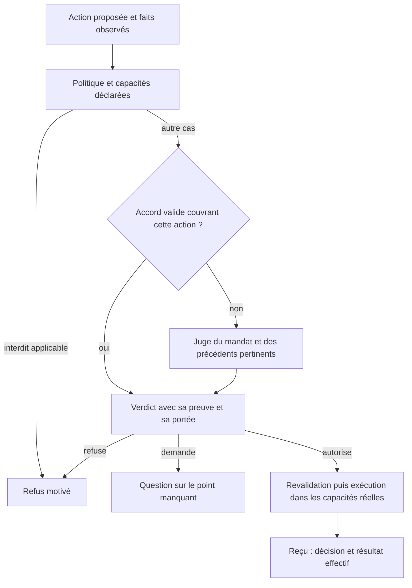

# Mode auto : comprendre la demande et réutiliser les accords

12 novembre 2026. Demande de Lucie : décider quelles actions sont cohérentes avec
son objectif, reconnaître les autorisations pertinentes déjà données et réserver
les interruptions aux décisions qui lui appartiennent réellement.

**Conception proposée, aucun raccord de production livré par cette note.**
[Ticket ouvert](../../rag3weaver-archi/tickets/2026-11-12-le-mode-auto-doit-juger-le-contexte-et-les-accords.md).
L'étude consulte documentation et code public ; elle ne lance aucun modèle,
service, banc ou changement de permissions.

## Le socle du projet existe déjà

Lecture du code sur `adcf01128527f4cb24027364489bd44e322ca089` :

- `commande.rs` possède `Mode::Auto`, la `Sentinelle` enfichable, les décisions
  Autorise/Demande/Refuse et un verdict avec portée, fondement, faits et motif.
  `Garde::new` utilise une sentinelle de règles ; son contexte reçoit surtout
  un booléen d'accord et un domaine, pas un objectif utilisateur documenté.
- Les acquis et les accords de lignes existent. Le correctif des accords lie
  une ligne complète au domaine canonique et consomme atomiquement CetteFois.
  Les anciens acquis de familles et de commandes affichées restent un mécanisme
  distinct : ils ne prouvent pas déjà le contrat d'accord sémantique décrit ici.
- `Verdict::borner` distingue l'avis du juge du consentement humain et borne les
  portées. Une extension contextuelle doit conserver cette distinction.
- L'accord de commande et l'accès au système de fichiers sont distincts : le
  parcours navigateur du 12 novembre déclare la lecture du seul script extérieur
  avant d'accorder sa commande. Le bac à sable ne s'élargit pas au clic.

Il faut enrichir ce modèle commun et son raccord réel au chat. Le nom Auto dans
le runtime ne prouve ni ce branchement ni une compréhension de l'intention.
La conception complète la [vision des commandes du 30 août](vision-roadmap-09-2026/11-donner-des-commandes-a-un-agent.md)
et la [vision des contrats d'effets](2026-11-11-applications-declaratives-et-contrats-d-effets.md).

## Ce que montrent les autres projets

Les observations suivantes portent sur les révisions liées, pas sur toutes les
versions de chaque produit. Une fonctionnalité présente en source peut être
conditionnée par la configuration et ne constitue pas une garantie mesurée.

| Projet observé | Mécanisme intéressant | Conséquence pour notre proposition |
|---|---|---|
| OpenCode, révision `ec263d62b6e3bfd7df6e5a256d1148b0b277bc1e` | Les règles décrivent action, ressource et effet. Le moteur applique les refus configurés avant les accords sauvegardés. Un accord durable stocke les motifs proposés par l'outil, par projet ; les demandes en attente peuvent être réévaluées après cet accord. | Reprendre le registre inspectable et révocable, les portées précises et la réévaluation des demandes couvertes. Un motif de commande reste une règle, pas une compréhension de l'objectif. |
| Gemini CLI, révision `aeb6c04b093eb00c33585ba587c4889ae4c5e957` | Le module Conseca, conditionné par `enableConseca`, génère une politique temporaire à partir de la demande utilisateur et des outils, puis évalue les arguments de chaque appel contre cette politique. Il réutilise la politique pour la même demande. | Très proche du besoin : distinguer l'interprétation du mandat et le jugement de l'action. Notre mandat doit conserver les consignes encore actives, y compris après une simple question de statut. |
| Cline, révision `50e77bc1e8f7ab023b7986821e4b5f82ff51b8c4` | La documentation distingue des catégories d'actions et le périmètre intérieur/extérieur du workspace. Elle indique que le modèle fournit le marqueur `requires_approval` des commandes. | Une interface par capacités est lisible. La déclaration de l'agent exécutant reste une proposition à contrôler ; elle ne suffit pas à produire un consentement humain. |

Sources primaires lues :

- OpenCode : [documentation des permissions V2](https://opencode.ai/docs/permissions/),
  [évaluation et réponses](https://github.com/anomalyco/opencode/blob/ec263d62b6e3bfd7df6e5a256d1148b0b277bc1e/packages/core/src/permission.ts),
  [stockage des accords](https://github.com/anomalyco/opencode/blob/ec263d62b6e3bfd7df6e5a256d1148b0b277bc1e/packages/core/src/permission/saved.ts).
  Les noms V2 diffèrent de ceux des anciennes pages V1 : cette étude ne mélange
  pas leurs champs de configuration.
- Gemini CLI : [politique déterministe](https://geminicli.com/docs/core/policy-engine/),
  [générateur Conseca](https://github.com/google-gemini/gemini-cli/blob/aeb6c04b093eb00c33585ba587c4889ae4c5e957/packages/core/src/safety/conseca/policy-generator.ts),
  [évaluateur](https://github.com/google-gemini/gemini-cli/blob/aeb6c04b093eb00c33585ba587c4889ae4c5e957/packages/core/src/safety/conseca/policy-enforcer.ts),
  [cache de politique et demande utilisée](https://github.com/google-gemini/gemini-cli/blob/aeb6c04b093eb00c33585ba587c4889ae4c5e957/packages/core/src/safety/conseca/conseca.ts),
  [contexte](https://github.com/google-gemini/gemini-cli/blob/aeb6c04b093eb00c33585ba587c4889ae4c5e957/packages/core/src/safety/context-builder.ts)
  et [exécution bornée des vérificateurs](https://github.com/google-gemini/gemini-cli/blob/aeb6c04b093eb00c33585ba587c4889ae4c5e957/packages/core/src/safety/checker-runner.ts).
- Cline : [documentation à la révision observée](https://github.com/cline/cline/blob/50e77bc1e8f7ab023b7986821e4b5f82ff51b8c4/docs/features/auto-approve.mdx).

Limite importante de l'inspiration Conseca : des chemins d'erreur internes du
générateur/évaluateur renvoient une décision ALLOW avec une erreur. Le runner
traite, lui, des exceptions et délais par DENY. Cette lecture ne démontre pas
le comportement de tout Gemini CLI. Pour notre conception, une permission qui
dépend d'un jugement indisponible reste non établie ; les règles et acquis déjà
valides peuvent continuer à fonctionner.

## Proposition : une sentinelle contextuelle commune

L'unité de décision est une action avec ses effets et ses ressources. Elle doit
servir le chat de l'atelier et les autres clients, puis s'étendre aux outils qui
lisent, écrivent ou appellent un service. La ligne de commande est un premier
adaptateur, pas le modèle universel de toutes les permissions.

Le juge reçoit trois ensembles clairement séparés :

1. **Le mandat actif** : objectif et consignes utilisateur, leurs identifiants
   sources, périmètre de travail, corrections et décisions encore en vigueur.
   « Ça avance ? » ne remplace pas la tâche en cours. Un résumé aide à retrouver
   le mandat ; il ne devient pas l'autorité qui l'a accordé.
2. **L'action** : outil, arguments structurés, cwd, dépôt/worktree et ressources
   résolues, effets observés ou inconnus, destinations et coûts pertinents.
   L'agent peut expliquer son intention ; l'exécuteur fournit les faits qu'il
   sait réellement vérifier. Un programme peut exécuter du code du dépôt : le
   nom `test` ne constitue pas une preuve d'absence de tout autre effet.
3. **Les précédents** : accords et refus pertinents, portée, fondement, auteur,
   validité et résultat. La recherche peut rapprocher des cas ; seule une preuve
   de couverture ou un nouveau jugement borné justifie la décision.

Les fichiers consultés, sorties d'outils et souvenirs sont des observations avec
leur provenance. Ils ne peuvent pas introduire une nouvelle instruction humaine
ou fabriquer un accord. Le contexte transmis au décideur se limite aux éléments
utiles et respecte la politique de données du fournisseur choisi.

### Ce que signifie « c'est du même style »

Il faut distinguer deux résultats, même quand tous deux évitent une question :

- **L'accord couvre l'action** : les contraintes du précédent correspondent
  effectivement à l'action présente. Le verdict cite cet accord.
- **La nouvelle action est cohérente avec le mandat** : un précédent aide le
  juge à comprendre la tâche, mais ne couvre pas cette action. L'autorisation
  est alors automatique et bornée par la politique, avec son propre fondement.
  Elle n'est pas renommée consentement humain.

Exemple : après « corrige ce bug et lance les tests », une nouvelle sélection de
tests dans le même workspace peut être cohérente. Un oui sur une commande précise
ne devient pas un oui sur tout le programme, tous les chemins ou toutes les
destinations. Un changement vers une publication distante, un autre dépôt ou
une suppression de données doit être examiné selon ses effets réels.

Une demande utilisateur déjà explicite est elle-même une source de consentement
à qualifier ; il ne faut pas réclamer mécaniquement un second oui. La traduction
de cette consigne en portée doit conserver la source et ses restrictions. Une
opération absente ou ambiguë dans la demande reste à trancher, conformément aux
interdits et aux règles d'engagement du projet.

### L'accord est une donnée avec une portée

Proposition de contenu sémantique, pas une nouvelle API déjà disponible :

| Élément | Garantie recherchée |
|---|---|
| Origine | Distinguer instruction utilisateur, bouton d'accord, configuration et décision automatique. |
| Action et effets | Identifier ce qui est permis, ses paramètres variables et les effets exclus. |
| Ressources | Dépôt, worktree, chemins ou service/destination ; aucun droit déduit du seul nom du programme. |
| Durée | Une consommation, tâche, session ou politique persistée explicitement ; expiration et révocation observables. |
| Preuve | Référence de la décision/source, contraintes vérifiées et version de politique/mandat. |

CetteFois reste consommée atomiquement au moment de délivrer le droit d'exécuter.
Un avis du modèle ne peut pas élargir lui-même sa portée ou persister une règle.
Les variantes actuelles de Portee sont à raccorder à ces garanties, pas à
remplacer par une deuxième liste indépendante dans l'IDE.

Après révocation, changement de périmètre ou nouvelle politique, un résultat
mis en cache doit être revalidé. Les modifications normales du code pendant une
tâche ne doivent pas invalider aveuglément tous les accords de tests : les
contraintes pertinentes sont celles de la capacité autorisée et de ses limites.

### Sortie et panne

Réutiliser Verdict : décision, fondement, portée bornée, faits et motif. Ajouter
les références du mandat et des accords examinés, les contraintes vérifiées et
ce qui manque pour décider. Une demande doit nommer le point à trancher ; un
refus déjà expliqué ne se contourne pas par une reformulation cosmétique.

Le modèle intervient dans les cas utiles, après les règles et accords exacts.
Une politique temporaire par tâche, puis des évaluations ciblées des actions
nouvelles, peuvent réduire la latence ; c'est une hypothèse à mesurer.
Le trait Sentinelle actuel est synchrone : un raccord d'inférence devra traiter
explicitement attente, annulation et délais, sans bloquer tout le chat.

Réponse invalide, contexte requis absent ou délai dépassé : aucune nouvelle
permission n'est acquise. L'interface expose le point manquant. L'exécution
revalide toujours l'accord et les capacités effectives ; un refus du bac à sable
reste un résultat distinct, visible, sans élargissement silencieux.

## Parcours et preuves à préparer

Les actions autorisées automatiquement continuent leur travail et conservent un
reçu bref, inspectable : décision, raison et accord réutilisé ou mandat concerné.
Les accords actifs sont visibles et révocables. Une question porte sur la portée
utile à la tâche : cette fois, action définie pendant la tâche, ou règle explicite
du projet. Aucun bouton vague « toujours » ne cache l'étendue réellement sauvée.

| Cas de validation proposé | Résultat attendu |
|---|---|
| Lire/modifier/tester dans la demande et les capacités déclarées | Poursuite sans interruptions répétées, justification et résultat réel visibles. |
| Refaire une action couverte, variantes autorisées explicitement | Réutilisation de l'accord avec ses bornes. |
| Même préfixe, autre cible, autre destination ou effet supplémentaire | Nouveau jugement ; aucune extension automatique du consentement précédent. |
| Instruction utilisateur explicite déjà donnée | Prise en compte de cette source, sans deuxième confirmation systématique. |
| Question de statut ou compression du chat | Mandat et accords actifs conservés par leurs références fiables. |
| Refus, révocation, changement de workspace/mode | Cache invalidé et portée respectée, y compris deux appels concurrents. |
| Fichier ou sortie qui prétend autoriser une action | Observation sans autorité pour accorder. |
| Modèle muet, réponse invalide ou effets inconnus déterminants | Permission non établie et explication utile. |
| Accord de commande avec accès fichier non déclaré | Limite nommée et résultat réel ; aucun faux succès ni boucle de demandes identiques. |

Mesurer les interruptions évitées, les questions nécessaires, les autorisations
hors mandat et la latence sur les mêmes cas. L'abstention correcte compte autant
que l'autorisation correcte. Aucune performance de ce décideur n'est mesurée ici.

## Suite proposée, à autoriser séparément

1. Arrêter le contrat commun de mandat, effets et accords, avec migration des
   acquis existants et preuve de consommation/révocation.
2. Construire des cas contrastifs et un évaluateur à blanc qui ne délivre aucun
   droit d'exécution ; comparer règles seules et jugement contextuel.
3. Raccorder un décideur borné au mode Auto et prouver le vrai parcours du chat,
   ses reprises et ses refus ; choisir ensuite l'interface des portées.

Le modèle local ou distant reste à choisir par preuve de qualité et de délai.
Le jugement peut se composer avec les contrats, graphes et capacités déclarés
existants ; il ne justifie pas un orchestrateur d'agents builtin. Cette porte
d'autorisation ne lance pas un équipier autonome en arrière-plan. Les choix de
persistance, la qualification des consignes naturelles et le périmètre exact
des classes d'actions devront être relus avant implantation.
