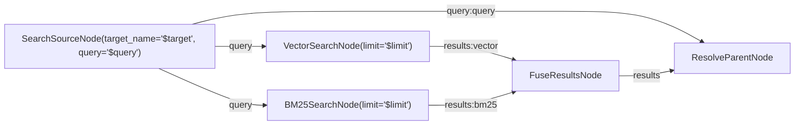
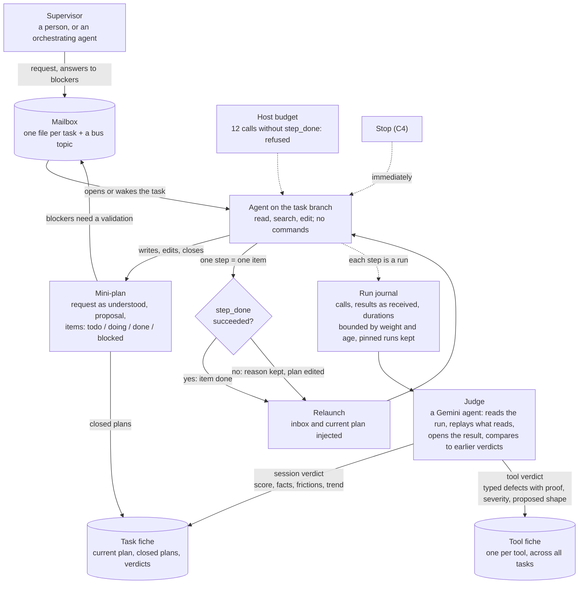

# rag3weaver

**Work in progress.** A Rust agent runtime and orchestrator where an agent's
whole world lives in one embedded database: the data, the words, the vectors,
the code graph, the processing graphs, the tools, the sessions and the memories
— all declared, all addressable, all in one process.

It runs on [rag3db](../../README.md) (graph + HNSW, embedded) and on
[lucivy](https://github.com/L-Defraiteur/lucivy/) 4.3.2 (BM25, in-process). Native only.

## The idea

*Everything lives in one system, and everything in it is declared.*

A knowledge base is a declaration (`EntityConfig`): its fields, its chunking,
its relations, its search signals. A processing step is a graph of typed nodes,
written as a Mermaid diagram. A tool for the agent is a node. A memory is a
template. One more declared thing, and the system knows how to ingest it, index
it, search it, and show what it did, node by node.

The aim, in one image: *you talk to your code or to your site, and it changes in
front of you* — no report to read, the screen shows what happens, and everything
is clickable. The long version (French):
[`visions/00-vision-generale.md`](visions/00-vision-generale.md).

## What exists today

| Layer | What it is | State |
|---|---|---|
| ingestion | records → chunks → rows → links → embeddings, by batches, resumable after a crash | delivered, measured on benches |
| hybrid search | BM25 (lucivy) + dense HNSW + learned sparse, rank fusion with exact matches first, per-signal scores, highlighted passages, optional cross-encoder reranking | delivered |
| dataflow | a DAG runtime with typed ports, 56 built-in nodes (71 with `code`), Mermaid templates, sub-graphs called once or per item, execution reports, checkpoints and undo | delivered |
| code graph | `codeparsers` (submodule, 13 languages): scopes, symbols, usages, impact, links between files, C and C++ calls resolved through their `#include`s; a synchronizer that re-indexes what changed | delivered |
| the agent's backend | `rag3weaver-backend` and `rag3weaver-chat`: search, read, grep, edit, run, sections after each tool; models through an OpenAI-compatible API, the Anthropic Messages API, or a local server | delivered, in daily use on this repository |
| the teammate | an agent that works alone on a task branch, step by step, and talks to its supervisor through a mailbox | delivered |
| Claude Code and Codex | hooks that bring the memory into a Claude Code session, a mailbox and a channel shared by sessions, Codex threads and teammates | delivered; Codex delivery tested against a stand-in, not yet against Codex itself |
| the IDE and the terminal | a React IDE served by the host; `rag3weaver-tty`, a terminal client that also works over ssh | delivered |
| embeddings | granite-embedding-278m by default (107m on a first large index or a weak GPU), MiniLM, multilingual MiniLM, BGE-M3 — all on burn/wgpu (Vulkan); an embedding service and a daemon (`rag3daemon`, `rag3weaver-embeddings`) | delivered |
| multi-tenant | `org` × `project` on every row, one FTS and sparse index per cell | delivered |
| other backends | `SchemaDialect` trait with a PostgreSQL implementation (`postgres` feature); declared Plans render a read in both dialects | partial — the contract a dialect must honour is not written yet |
| long memory | the `memory` template: cards as Markdown files, rebuilt from their folder if the database is lost; references, states, `cited_by`, `whois` | delivered; an archivist that sorts and merges cards is in progress |
| context cards, declared backend and views, talking to a page | | visions — nothing coded |

For JavaScript and TypeScript, dependency links follow a resolved relative
`require` or default import to the module's exported symbol or value, including
when its local alias has a different name. An exported instance leads to its
export zone, not to its constructor class. Missing or external modules retain
a binding marked `resolution = "liaison"`; ambiguous default exports are left
unresolved. This is dependency navigation: a language server may instead return
the local alias declaration. The graph's representative line does not identify
every source occurrence. The strict LSP comparison and its attribution limits
are recorded in [the validation report](../../docs/codeparsers/11-11-2026/04-bilan-navigation-et-provenance.md).

## Shared indexed content

A derived entity can opt into immutable content versions with
`derived.identity = {"mode":"content","format":"plain-v1"}`. Occurrences
whose rendered fields match share a version, its chunks and its stored vectors
within that derived entity and `org` × `project` cell. Identity includes the
format, field roles and chunking recipe; this is not a global text cache.
The default remains one derived identity per root.

These are two `EntityConfig` fragments, not a complete backend manifest (which
also declares each entity's JSON schema and the backend settings):

```json
{
  "Occurrence": {
    "fields": {
      "key": {"type":"string"},
      "body": {"type":"string","isContent":true}
    },
    "hashsafe": ["key"],
    "signals": [],
    "chunked": false,
    "searchIndex": "IndexedText"
  },
  "IndexedText": {
    "fields": {"body":{"type":"string","isContent":true}},
    "signals": ["bm25","vector"],
    "derived": {
      "from": "Occurrence",
      "identity": {"mode":"content","format":"plain-v1"},
      "render": {"body":"{{ root.body }}"}
    }
  }
}
```

`searchIndex` routes public searches on `Occurrence` through `IndexedText`.
Results keep the root occurrence's UUID and data. The query's cell, view and
root filter restrict eligible versions before top-k; versions expand back to
admitted occurrences before fusion and pagination. Indexed content and title
fields must preserve the root's bytes: a transformation requiring offset
remapping is refused. Direct public searches on the internal content index
are refused too.

Updating a root atomically moves its canonical `DERIVED_FROM` reference;
other occurrences keep their version. Old versions are retained, with no
orphan garbage collection. Direct edits to content versions and canonical
references are refused. Input columns remain stored on each occurrence.
Changing identity mode or format, or changing `searchIndex` on a populated
entity, requires a migration; no automatic migration is provided. Production
code templates do not enable this option, and no total database size saving
has been measured.

Queue inspection (`has_pending`, `pending_work`, `drain_stats.pending`) describes
only the active cell, which the next drain can write. The catalogue-wide
`index_progress.writes_pending` includes parked cells; changing cells preserves
their accepted work. Cumulative drain counters describe the catalogue's history.

## Migration diagnostics

Inspect storage or resolve a preliminary plan from declared Mermaid files:

```bash
rag3weaver-backend migration inspect --manifest backend.json
rag3weaver-backend migration plan --manifest backend.json --dir migrations --var name=value
```

These commands use a read-only metadata snapshot without initializing a
catalog or connecting models. The plan checks its files against the journal
through the existing runner: versions, names and checksums must match. A legacy
`applied` row without a durable resolved-plan identity cannot qualify a resolved
plan. A missing data generation is reported as `Unversioned`, never as zero or
as a hash of the schema.

The optional manifest `storage` requirement names an `application_format` and
`recipe`; declaring it does not upgrade storage. On-disk backend entrypoints
validate the declarative schema first, then inspect storage before acquiring a
writer or constructing models. Legacy manifests still open without a data
generation; an unpublished versioned target is refused.

The result is diagnostic: `migration apply` returns an explicit unavailable
error. This interface does not transfer chunks or vectors, publish a migrated
format, activate code templates, or provide migration recovery/rollback.

## Measured

First index of this repository (about 7 000 files, 80 000 scopes, 1.1 million
relations), on disk, with embeddings:

| | September 2026 | 8 October 2026 |
|---|---|---|
| duration | 753 s | **78 s** (median of three runs) |
| peak memory | | 9 Go |
| first searchable results | at the end | after 8–10 s |

The 78 s comes from three settings that are **the defaults since 10 October
2026**: full text stored beside the database as files (instead of blobs inside
it) for a new database, one transaction per batch, and batches of 2 048 files.
Each can be turned back: `RAG3WEAVER_FTS=blobs`, `RAG3WEAVER_TX_PAR_PAQUET=0`,
`RAG3WEAVER_BATCH_FILES=64`. Numbers come from a held measurement on one machine
(AMD Radeon 8060S); they say "faster", not "fast everywhere".

## Quick start

```rust
let mut catalog = Catalog::new(conn, embedder, config);
catalog.initialize().await?;

catalog.register_entity("Product", EntityConfig {
    fields: vec![
        SimpleFieldDef::new("name", FieldType::String, FieldRole::Title),
        SimpleFieldDef::new("description", FieldType::Text, FieldRole::Content),
    ],
    signals: SearchSignals::BM25 | SearchSignals::VECTOR,
    ..Default::default()
}).await?;

catalog.ingest_entities("Product", vec![
    btree_map!{ "name" => "Rust Book", "description" => "A guide to Rust..." },
]).await?;

let response = catalog.search("Product", "rust ownership", SearchOptions::default()).await?;
for r in &response.results {
    println!("{} (score={:.4})", r.uuid, r.score);
}
```

A search is itself a graph. The same thing as a Mermaid template
(`templates/simple_hybrid_search.mmd`):



```rust
let (output, report) = runtime.execute_with_report(&mut graph).await?;
// report.nodes: name, status, duration_ms, output ports, metrics
// report.edges: from, to, value summary
```

## Search

Three signals, combinable as bitflags (`BM25`, `VECTOR`, `SPARSE`), fused by
reciprocal rank (or weighted), with each signal either feeding candidates or
boosting them. BM25 has six query modes — `Auto` (the default), `Contains`
(substring across tokens, fuzzy, relaxed separators), `ContainsSplit`, `Regex`,
`Parse` (boolean syntax), `Symbol` (exact, separators included: `foo->bar`,
`std::sync::Arc<Mutex<T>>`).

With `Auto`, a query goes to lucivy twice, in parallel: whole, as one substring
at distance 1, and word by word. What the whole query found is ranked ahead of
everything the fusion ranked, so a sentence copied from a file brings that file
back first. A long query is bounded and says so in `SearchMeta.warnings`: past
900 characters the whole query is searched without fuzziness, and the word
search keeps the 64 longest terms. lucivy treats `'` and `’` as the same
apostrophe since 4.3.2.

Each result says what each signal made of it — score and rank in that signal's
own list (`signals`), the signal that weighs most in its fused rank
(`bestSignal`), and the scale of its chunk's score (`chunk.signal`); the chunk
shown is the one from that signal. These scores are not comparable with each
other. Each chunk carries its highlighted passages (`highlights`, in UTF-16
units of the chunk text): the spans lucivy found, and, with
`options.highlights = "sparse"`, passages of a chunk found by the dense signal
alone, from the positions the bge-m3 service weighs (no tokenizer or model in
the host; the query words instead when the service does not answer). Engine
warnings come back in `SearchMeta.warnings` on every search; the `search_code`
tool also returns its metadata as JSON.

When a signal is unavailable or fails, the search falls back on the others and
says so in its status (`signal is not available` / `signal failed`) — never a
silent empty result. A vector index that is being rebuilt, missing or
incomplete makes the dense signal step aside, by name, while the words answer.
At the end of each index run, every full-text index counts its documents
against the rows and reports a gap. A filtered search reads all its signals
from the same committed state, and a filter applies to the learned-sparse
signal too.

When a dense or learned-sparse chunk points to several occurrences, search
returns every occurrence admitted by the request, with its own fields, file
positions and source attribution. Each occurrence keeps its best matching
score; ties have a stable order. Existing filters and cell selection still
apply. Content-addressed storage and layered worktree/branch views remain
under development; this projection does not enable them.

Full text is stored either **as files in `<base>.fts/`** (the default for a new
database on disk: lower memory, faster reopen; the folder is part of the database,
copy and back it up with it) or **in the database as blobs** (an existing database
that has them keeps them, and `RAG3WEAVER_FTS=blobs` asks for them). A database in
memory keeps its full text in itself.

The dense index prunes its HNSW graph with the classic heuristic since 10 October
2026 (engine `9a2818df9`): no row is left unreachable by its own vector, at +3 to 5 %
per query. **An existing index keeps its old graph** (the format does not change, only
the neighbour lists a write touches are rewritten); to get the new pruning, recreate it
(`DROP_VECTOR_INDEX`, then `CREATE_VECTOR_INDEX`).

## The code graph

With the `code` feature, a repository becomes a graph: files, scopes, symbols,
`DEFINES`, `CONSUMES`, `REFERENCES`, `MENTIONS` edges, with a `resolution` mark on each
edge saying how it was found (by path, by name, guessed). A C or C++ call is
resolved only to what its file includes. The synchronizer
indexes by batches, marks what it has proven, and on restart redoes only what is
incomplete. Tools built on it: `usages`, `impact` (what depends on this), links
rendered as a tree.

## The agent

rag3weaver is not a library an agent calls; it is where the agent runs.

- **The loop** (`agent.rs`): generate, execute the requested tools, feed the
  results back, start again — until the model answers or a bound bites. It is
  short because everything it assembles already exists.
- **Tools are nodes.** A tool definition for the model is generated from a
  node's schema (`tools.rs`): name, description, typed parameters. Nothing is
  written twice, and a tool call is a graph execution, with its report.
- **A backend is a manifest** (`backend.rs`): payload schemas and the graph
  tools it chooses to expose. No domain vocabulary in the engine; the code
  backend (`backend_code.rs`) declares its `workspace` — which files, under
  which root, read-only or not, with which command gate — so the same engine
  serves a cloud agent on a snapshot and a desktop agent on the real tree.
  When the root disappears from disk, `daemon_status` says « racine absente :
  <path> » and every tool that touches the files names the cause instead of
  returning a raw I/O error.
  A manifest can declare rendered entities with `derived.from` and `gather`.
  Omit `hashsafe` on a derived entity: the derivation defines its identity.
  Opening orders entities and relations by their dependencies; missing roots,
  invalid gather rules and dependency cycles are refused before any database call.
  A derived entity cannot itself be used as another derivation's `from`.
- **Sessions, postures, work domain** (`session.rs`, `postures.rs`,
  `work_domain.rs`): what is kept from one turn to the next and what stops
  being paid for; who stayed silent towards whom in a multi-party
  conversation; the dispersed set of repositories and notes an agent has in
  view.
- **Event-driven graphs** (`dataflow/reactor.rs`, `react_nodes.rs`): a graph
  declares what it reacts to on the bus (`each` / `batch` / `debounce`) and
  runs when it happens — the piece that lets a change in the data trigger
  work.
- **The model is a service**, like the embedder: `LlmNode`, a `decider`
  (a text, a closed list of options, a probability per option), an
  OpenAI-compatible client, the Anthropic Messages API (`anthropic-llm`,
  `"protocol": "anthropic"` in `models.llm`) or a local server, all behind the
  same `Llm` trait; streaming is in the trait, and a model may declare its
  reasoning budget (`models.llm.reasoning`). A refused call (429, 503) is
  retried after a minute, then twice as long each time, ten minutes and five
  retries at most; each backoff is written to the log and to the chat status
  with its number, code and wait. Each caller bounds its backoffs — a chat turn
  five minutes, a teammate step two, the judge ten — and past that the call
  fails, naming the cause and the time waited.

### Working alone: steps, a judge, a memory

An agent that works on its own is not one long turn. It writes a **mini-plan**,
does one item per **step**, declares the step done or failed, and is relaunched
with what arrived meanwhile. Every step is a **run** in the host's journal, and a
**judge** reads each run: one verdict on the session, one on every tool it
called. Both land in the memory as fiches, where the trend across runs is what
decides the next move. The supervisor (a person, or an orchestrating agent) only
ever writes to a mailbox.

The memory archivist can file document sections under cards with long names,
including judge reports. It preserves the exact card identity and refuses an
unknown or ambiguous candidate identifier.



All of it is on master: the step loop, the mini-plan and the mailbox
(`0ab04909a`), the run journal and the session judge, the tool verdicts (missing
or misnamed parameter, a parameter that should be optional, a return that is
malformed, inconsistent, verbose, off-topic or incomplete, each with its call id
and a proposed shape, kept in a fiche per tool), and the journal bounded by
weight and age with pinned runs. Since then:

- **Each step starts a fresh thread**, carrying the request, the last 20 step
  results, the mailbox and the plan — a long task no longer drags its whole
  history into every call.
- **A question waits for its answer.** An unanswered question or approval
  suspends the teammate without calling the model; the mailbox says since when,
  and the step counts neither as done nor as failed.
- **Commands go through the gate.** In a task whose workspace declares a command
  gate, a command the gate holds becomes an approval in the mailbox; the
  workspace's declared scripts are pre-approved. The Landlock sandbox can run
  `cargo`, with a target shared per repository and the network closed.
- **A provider out of quota is waited for**, not counted as a failure: the same
  step is replayed after a growing delay, and the teammate stops after ten such
  steps, or at once on an exhausted daily quota. It resumes after a host
  restart, and a working teammate keeps the host from going idle.
- **Without its backend, it still reads and edits** the task's files, and says
  so; it stops after three failed steps in a row.
- **A task without git.** A task on a folder that no repository tracks opens
  in a copy of that folder, is reviewed by difference and merged back by copy,
  refused if the folder moved meanwhile. It writes in its copy when the
  workspace declares `task_writes`; `git_init` makes the folder a repository,
  only when declared.

The supervisor follows it at `/ide/teammate` (`/ide/teammate/mailbox`,
`/ide/teammate/pending`, `/ide/teammate/seen`, `/ide/teammate/list`), in the IDE
or in a terminal (below).

The binaries `rag3weaver-backend` and `rag3weaver-chat` are this runtime served
over HTTP, with sections rendered after each tool so that a person reading over
the agent's shoulder sees what it did. Every line of the host's log
(`daemon.log`) starts with its time to the millisecond and names the client,
session and repository of the call that wrote it. A second process that opens a
database for writing while another one holds it is refused with who holds it:
role, pid, since when, and the tool.

## The workshop

`rag3weaver-backend atelier` sets up a workshop: a chat whose space is the machine rather than a
branch of code. A new workshop takes the folder it is started from as its root, or `~/rw-code`
(created if missing) when started from the home folder or `/`; an existing workshop keeps its
root. In the chat, the workshop:

- attaches a worktree already on disk (`attach_worktree`), or opens a branch in a sibling worktree
  (`open_branch`, the git command it ran said in the answer); each is registered, opened and
  indexed in the background, and its progress and end show under the call and in the sidebar;
  `list_worktrees` gives each one's path, repository, branch, index and explicit context reference;
  nothing is cloned or pushed;
- searches and navigates an explicitly selected attached context with `search_code`, `grep_files`,
  `list_files`, `outline`, `usages`, `impact`, `callees` and `schema`. Pass the context returned by
  `list_worktrees` as `context: {target: {kind: "backend", id: "..."}}`, alongside the usual tool
  arguments (`query` and `options` for search, `path` for outline). Unknown or ambiguous targets,
  self-calls and unsupported views are refused; the runtime never selects the first repository;
- follows a command's returned journal with `wait_output`, using the existing bounded journal reader;
- reads a file 200 lines at a time (`read_file`), or a scope from the index of an attached worktree
  by its name (`read_scope`);
- writes with `replace_text` (an old text that appears exactly once), `replace_lines` and
  `insert_lines`; the line edits require that those lines were read in this turn or the previous
  one. Every write returns the unified diff, and a write inside an attached worktree reindexes it;
- writes a worktree it opened itself without asking; anything outside its root, and any worktree
  the user holds, goes through `ask_permission`: a card under the call, granted or refused by the
  user, and recorded one line per decision in `decisions.jsonl` next to the run journal;
- runs commands through its gate (`run_command`); a command the gate puts on hold shows the same
  card under the call, with the command line. A grant covers the complete exact line in the
  same working domain, including an explicitly approved outside path. Changed arguments,
  command chains or working domains need their own grant; sandbox rules still apply.
  The decision starts the next turn by itself: the model reads "granted: run it again" or
  "refused", and the user types nothing. A decision on a path card starts the turn again the
  same way.

## Claude Code and Codex

The memory and the mailbox reach agents that do not run in rag3weaver.

- **Hooks for Claude Code** (`rag3weaver-backend hook`, installed per session by
  `scripts/hooks_claude_code.sh`, never globally unless asked): at the start of
  a session, who you are and what you were holding; on each prompt, at most one
  related memory card, what others changed in the files you touched, the
  judge's last verdict on your task and the mailbox; after a compaction, the
  summary kept on the task card and an identity check; at about 70 % of the real
  context, a suggestion to tidy up. A recall that takes too long finishes in the
  background and shows at the next tool call, after a judge that can only
  remove candidates. A hook always exits 0 and is silent without a host. Its
  texts are templates (`templates/hooks/`).
- **A shared mailbox** (`rag3weaver-backend mail send|reply|pending|seen`):
  Claude Code sessions, Codex threads (`codex:<name>`) and teammates write to
  each other; a reply goes to the author of what it answers.
- **A channel** (`rag3weaver-backend canal`, an MCP server for Claude Code) that
  pushes mailbox items into a running session, with `reply`, `send` and `claim`.

## The IDE and the terminal

The host serves an IDE in React (`ui/ide/`, built into `templates/ide/app/` and
embedded, never loaded from elsewhere): the chat, files with in-page editing,
search, tasks and their review with the teammate, session verdicts, the tree,
symbols, the graph, the live DAG of a running tool (with a Stop button),
reactions and proposals. The chat keeps the order things happened in — words,
tool calls, the answer — during the turn and after a reload, each tool unfolded
with its time, duration and full result. If a later model call fails, completed tool calls
stay visible and a new message can resume the work. Turns started outside the form report
their actual failure or stop through the same event stream. A contextual tool result names its
repository; file and symbol links use the effective repository from its structured execution
receipt, including after a reload. A missing or unsupported context leaves those links inactive.
File references with a line range open at the first line. The sidebar speaks in repositories
(« Dépôts », « Mémoire », « Projets »), with a context gauge under each
conversation. Host state and completed chat turns arrive through the shared event stream:
an idle IDE sends no polling requests, and the sidebar's usage matches the chat state and
recap, including immediately after a turn. Search can be typed from the home page, across every index, and
the folder open in the tree filters it (the `scope` of `search_code`).
"My searches" lists the searches made in a repository,
by you and by agents under their name, with their first results and the ones you
clicked (`GET /ide/recherches`). Code in the chat is coloured by the same
tree-sitter grammars that index it (`POST /highlight`).

`rag3weaver-tty` (crate `tty/`) follows a teammate from a terminal: the agent's
text scrolls into the terminal's own history and three lines are redrawn at the
bottom; Enter talks to the teammate, Esc stops it. It works over ssh (at most
30 redraws per second), resumes after a cut without loss or duplicate
(`Last-Event-ID`), degrades to 256 colours, 16, none and ASCII, and colours code
with the host's grammars and the theme `templates/themes/daemon.json`.
While the agent thinks, reads or writes, the view plays the Daemon Code
Summoning — runes, an alchemical symbol, a glitch — chosen by what the tool is
allowed to do, at most 1.6 KB/s over ssh. `--plain` writes the stream as text.

## Embeddings and rerankers

All production models run on burn (wgpu/Vulkan — AMD, NVIDIA, Apple with one
implementation); candle stays as the parity oracle (`candle-embedder`), checked
bit for bit, not by a rounded cosine.

| Model | Dims | Use |
|---|---|---|
| granite-embedding-278m-multilingual | 768 | default |
| granite-embedding-107m-multilingual | 384 | first index of a large repository, or a weak GPU |
| all-MiniLM-L6-v2, paraphrase-multilingual-MiniLM-L12-v2 | 384 | light |
| BGE-M3 | 1024 | dense + learned sparse in one forward pass (`DualEmbedder`) |

Rerankers (`RerankNode`, `set_reranker`): ms-marco MiniLM, mmarco multilingual
MiniLM, bge-reranker-v2-m3. OCR (`ocr`, `burn-ocr`): PP-OCR on burn. Weights are
not bundled; they are published as `burnpack` files with upstream attribution
(see `generated/README.md`).

Any provider plugs in through traits: `Embedder`, `SparseEmbedder`,
`DualEmbedder`, `Reranker` (and their `Callback*` helpers). The core has no ML
dependency.

## Features

No feature is on by default.

| Feature | What it adds |
|---|---|
| `rag3db-native` | the rag3db connection (links the shared library built from the fork) |
| `postgres` | the PostgreSQL dialect and blob store |
| `burn-embedder` | the burn models on Vulkan (`burn-rocm` for ROCm) |
| `candle-embedder`, `bge-m3`, `cuda` | the candle reference models |
| `code` | the code graph (`codeparsers`, sandboxed file access) |
| `daemon` | the embedding daemon and service client |
| `openai-llm` | an OpenAI-compatible LLM client |
| `anthropic-llm` | the Anthropic Messages API client (implies `openai-llm`) |
| `navigateur` | the IDE's tests in a headless browser |
| `ocr`, `burn-ocr` | OCR |

Runtime knobs are `RAG3WEAVER_*` environment variables (about sixty; the ones
that matter for ingestion are `RAG3WEAVER_EMBED_MODEL`, `RAG3WEAVER_EMBED_SERVICE`,
`RAG3WEAVER_GPU_DUTY`, `RAG3WEAVER_EMBED_CHAR_BUDGET`, `RAG3WEAVER_FTS`,
`RAG3WEAVER_TX_PAR_PAQUET`, `RAG3WEAVER_BATCH_FILES`,
`RAG3WEAVER_TX_PAQUETS_PAR_VALIDATION`). They are documented where they are read.

## Tests

```bash
cargo test --lib --features "rag3db-native"        # unit tests
./run_e2e.sh                                        # end-to-end suites (131 e2e_*.rs files under tests/)
./run_e2e.sh --test e2e_code                        # one suite
```

End-to-end tests link the rag3db shared library (see `BUILD.md` at the root).
Several suites embed on the GPU; the ones that measure durability kill the
process with the database open and replay the journal.

## Where things are

```
src/
├── catalog.rs, catalog/        register, ingest, search; the batch synchronizer
├── search*.rs, fts_*.rs        signals, fusion, lucivy handle, FTS storage modes
├── dataflow/                   graph, runtime, ports, 47 nodes, Mermaid, reports, checkpoints
├── code*.rs, backend*.rs       code graph, agent backend and its tools
├── burn_*.rs, candle_*.rs      models
├── dialect.rs                  SchemaDialect: rag3db, PostgreSQL
├── scope.rs                    org × project
├── daemon_host/                the host: run journal, judge, chat, tasks, teammate, Codex delivery
└── bin/                        rag3weaver-backend, rag3weaver-chat, rag3daemon, rag3weaver-embeddings, rag3db-check-lib
templates/                      Mermaid pipelines, backends, hooks, the IDE bundle, themes
ui/ide/                         the IDE (React)
tty/                            rag3weaver-tty
scripts/                        hooks_claude_code.sh and other tools
codeparsers/                    submodule
docs/                           design notes and session reports (French), dated folders
visions/                        where this is going (French)
```

## License

[Luciform Research Source License (LRSL) v1.2](LICENSE)
