<h1 align="center">rag3weaver</h1>

<p align="center"><b>Code and memory for your coding agents, kept fresh in one embedded database on your own machine.</b></p>

<p align="center">
  <a href="https://github.com/L-Defraiteur/rag3db/actions/workflows/rag3weaver-workflow.yml"></a>
  <a href="LICENSE"></a>
  <a href="https://www.npmjs.com/package/rag3db"></a>
  <a href="https://crates.io/crates/lucivy"></a>
  <a href="https://pypi.org/project/lucivy/"></a>
  <a href="https://www.npmjs.com/package/lucivy"></a>
</p>

rag3weaver indexes your repositories (code graph, full text, dense and sparse vectors), keeps a
long-term memory of your working sessions, and serves both to Claude Code, Codex or any MCP
client. Everything is declared in JSON and Mermaid, runs in one host process, and stores into
[rag3db](https://github.com/L-Defraiteur/rag3db), an embedded graph database, with
[lucivy](https://github.com/L-Defraiteur/lucivy/) for full text. Work in progress, native only.

## Get started

Index a repository and ask about it from your coding agent:

```sh
# a host that keeps the backends open (127.0.0.1:7970 by default)
rag3weaver-backend daemon &

# declare the repository and index it — run from the root of this crate
rag3weaver-backend code-tree add ~/src/my-repo --from templates/backends/code/backend.json

# serve it to your agent over MCP (Claude Code shown; any MCP client works)
claude mcp add my-repo -- rag3weaver-backend mcp \
  --manifest ~/.config/rag3weaver/code-my-repo/templates/backends/code/backend.json
```

Then ask your agent *“where is the config parsed?”*: it calls `search_code`, which answers from
the index, with paths and lines.

- Without an embedding service the index is **full text only** and the vectors wait (they are
  computed later, when a service is declared with `RAG3WEAVER_EMBED_SERVICE=host:port`).
- The binary must come from the same sources as the templates: this example works from the
  current `master` (the binary installed from `0b0ff221a` refuses the newer code template).
- The example is checked as written, on an isolated host, by
  [`scripts/test_readme_quickstart.sh`](scripts/test_readme_quickstart.sh).

## What you can do with it

<table>
<tr>
<td width="50%" valign="top">
<a href="docs/images/ide-index-par-worktree.png">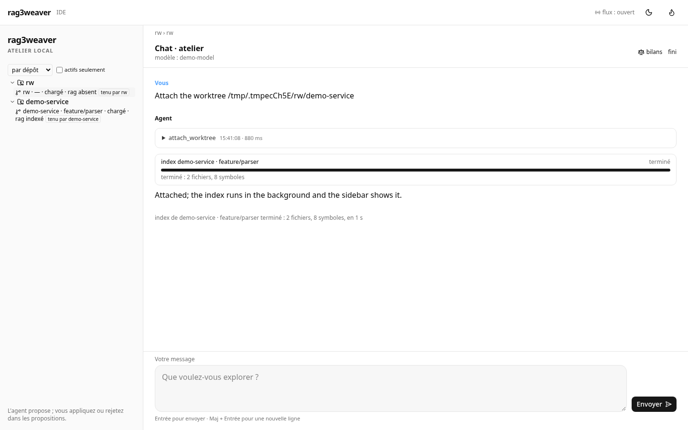</a>
<p><b>A code index per worktree, grouped by repository.</b> Attach a worktree from the chat; it
is indexed in the background and shows up under its repository and branch.
<a href="docs/07-novembre-2026-everything-declarative/03-l-atelier-ouvre-les-depots.md">Design</a></p>
</td>
<td width="50%" valign="top">
<a href="docs/images/memoire-recall.png">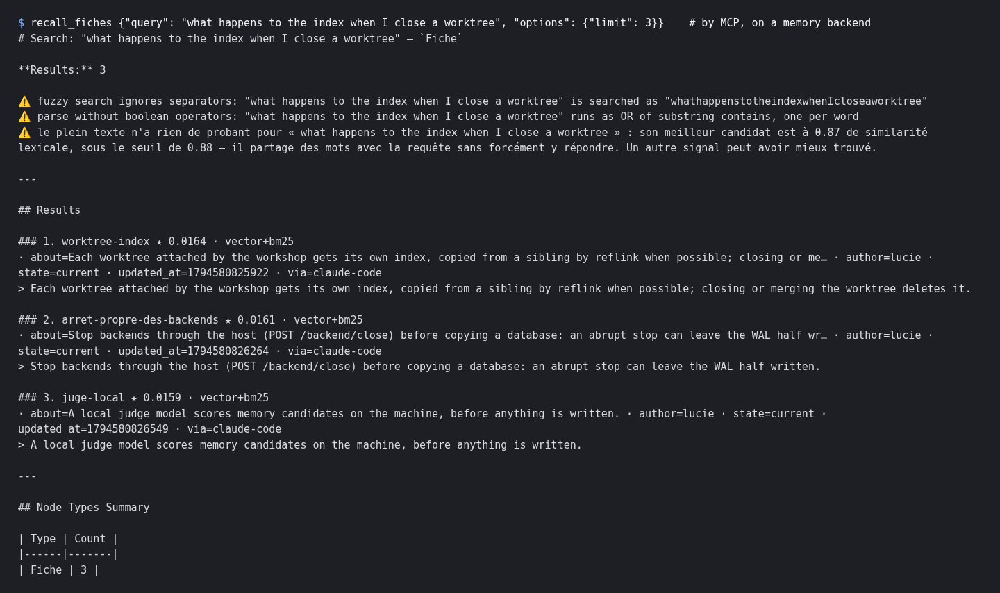</a>
<p><b>A long-term memory for your sessions.</b> Cards written by your agents (and by the hooks),
recalled by meaning and by words. Real output of <code>recall_fiches</code>.
<a href="docs/09-novembre-2026-memoire-longue/04-la-precision-du-rappel-d-aujourd-hui.md">Recall precision</a></p>
</td>
</tr>
<tr>
<td valign="top">
<a href="docs/images/ide-carte-d-accord.png">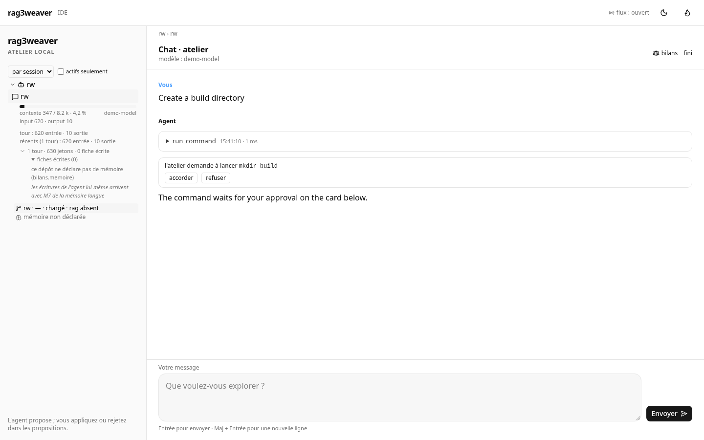</a>
<p><b>An agent that edits behind an approval card.</b> The workshop reads, writes and runs
commands; anything outside its root, or a command its gate holds, waits for your click.
<a href="docs/09-novembre-2026-atelier-lire-ecrire/01-conception.md">The workshop</a></p>
</td>
<td valign="top">
<a href="docs/images/ide-chat-et-jauge.png">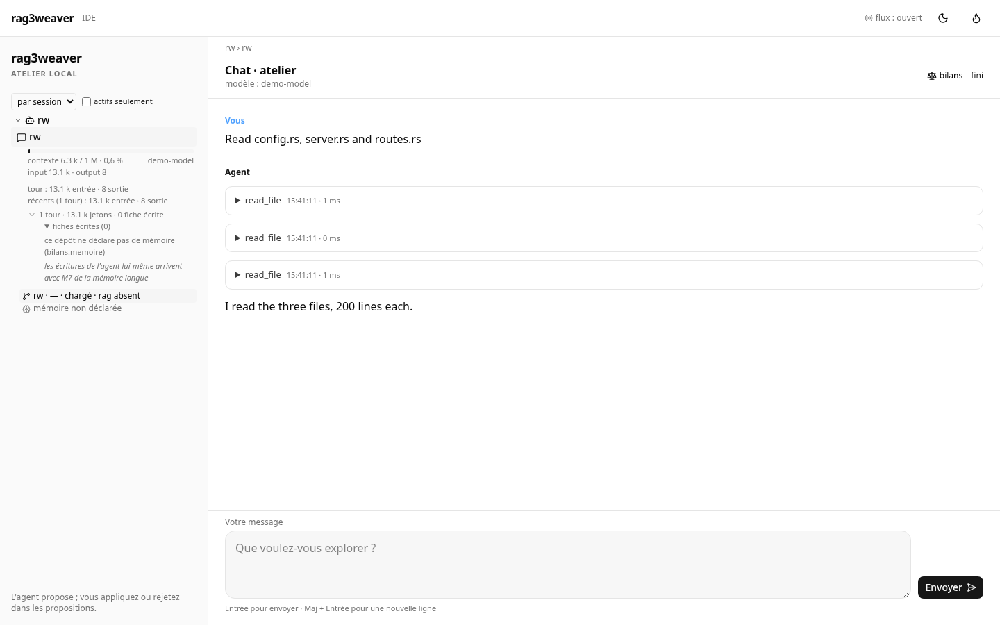</a>
<p><b>The IDE: the chat and its context gauge.</b> Every tool call, its result and the context
the last model call used, live from the host's event stream.
<a href="docs/09-novembre-2026-atelier-lire-ecrire/02-la-jauge-du-contexte.md">The gauge</a></p>
</td>
</tr>
<tr>
<td valign="top">
<a href="docs/images/juge-local.png">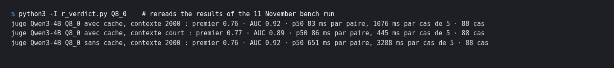</a>
<p><b>A local judge.</b> A small model on your machine decides which memory is worth keeping,
measured on 88 verified cases. Reread from the bench results, not a live run.
<a href="https://github.com/L-Defraiteur/rag3db/blob/master/docs/banc/11-11-2026/03-le-juge-en-gguf.md">The bench</a></p>
</td>
<td valign="top">
<a href="docs/images/trace-d-un-index.png">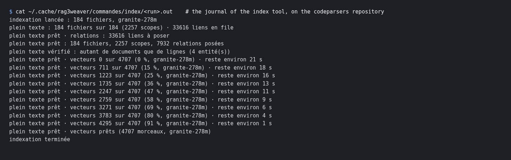</a>
<p><b>The trace of an index.</b> Full text is searchable first; vectors follow, with what is
left and how long. The journal is the contract: its last line says the end.</p>
</td>
</tr>
<tr>
<td valign="top">
<a href="docs/images/postgres.png">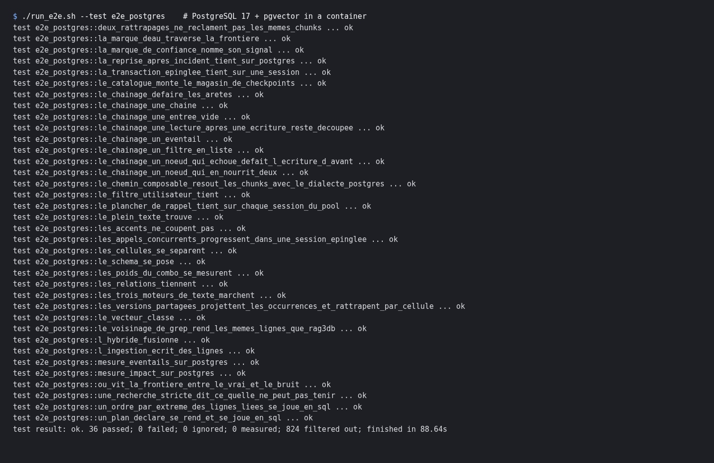</a>
<p><b>The same catalog on PostgreSQL.</b> The dialect runs the catalog on PostgreSQL + pgvector;
partial today (a repository backend cannot yet be declared on it). Real run of the e2e suite.</p>
</td>
<td valign="top">
<a href="docs/images/lucivy.png">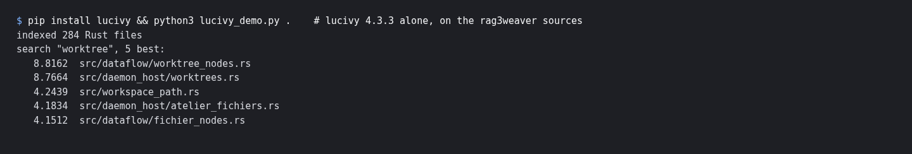</a>
<p><b>lucivy, on its own.</b> The full-text engine is a separate library on crates.io, PyPI and
npm. Real output of <a href="docs/images/sorties/lucivy_demo.py">this script</a>.</p>
</td>
</tr>
</table>

Every image is a real capture: the IDE views come from a test host behind a scripted model, the
terminals are real outputs kept in [`docs/images/sorties/`](docs/images/sorties/). They are all
regenerated by one ignored test, `daemon_host::captures_du_readme` (see
[`docs/images/README.md`](docs/images/README.md)).

## Why views per worktree?

A coding agent works on several branches at once, each in its own worktree. **Today** each
worktree gets its own index. A task's base is copied from its repository (by reflink when the
filesystem allows it) and deleted when the task is merged or rejected; a worktree opened by the
workshop starts from an empty base and indexes everything, vectors included, and keeps it until it
is removed. The sidebar groups them by repository and branch, and says the disk each one holds.

**Where it is going** (decided on 6 and 8 November 2026, not delivered yet): **one index per
repository**, and each worktree or branch a **view** over it — a filter, not a copy. What a branch
changes is indexed once; what it shares with its repository is shared.

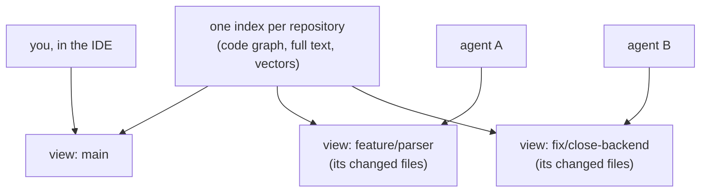

The design of the first step: [views, step 1](docs/08-novembre-2026-arbre/01-conception-des-vues-marche-1.md);
today's disk rule: [one worktree, one base](docs/07-novembre-2026-everything-declarative/03-l-atelier-ouvre-les-depots.md).

## What we measure

Every number comes with its method and its page; none is a promise for every machine.

| What | Result | Where it is measured |
|---|---|---|
| First index of the rag3db repository (about 7 000 files, 80 000 scopes, 1.1 million relations) | **78 s** (median of three runs, 8 October 2026), from 753 s in September; first searchable results after 8–10 s | [the indexing bench](docs/8-octobre-2026-16h29/embarquements/03-la-serie-d-avant-bascule.md) |
| Local judge (Qwen3-4B, Q8_0, cache) | first choice right **0.76**, **AUC 0.92**, median **83 ms** per pair, on 88 verified cases | [the judge bench](https://github.com/L-Defraiteur/rag3db/blob/master/docs/banc/11-11-2026/03-le-juge-en-gguf.md) |
| Precision of the memory recall slipped by the hooks | on 171 real recalls, **92 %** slipped no card; the content was missing, not the ranking | [the recall precision](https://github.com/L-Defraiteur/rag3db/blob/master/extension/rag3weaver/docs/09-novembre-2026-memoire-longue/04-la-precision-du-rappel-d-aujourd-hui.md) |
| `search_code`, full text only, on code-shaped queries | median **258 ms**, p95 **532 ms** (48 queries) | [the hooks search page](https://github.com/L-Defraiteur/rag3db/blob/master/extension/rag3weaver/docs/07-novembre-2026-hooks-essai/04-la-recherche-de-code-par-les-hooks.md) |

The first index settings that gave the 78 s are the defaults since 10 October 2026 (full text
stored beside the database as files, one transaction per batch, batches of 2 048 files); each can
be turned back: `RAG3WEAVER_FTS=blobs`, `RAG3WEAVER_TX_PAR_PAQUET=0`, `RAG3WEAVER_BATCH_FILES=64`.

## The idea

*Everything lives in one system, and everything in it is declared.*

A knowledge base is a declaration (`EntityConfig`): its fields, its chunking,
its relations, its search signals. A processing step is a graph of typed nodes,
written as a Mermaid diagram. A tool for the agent is a node. A memory is a
template. One more declared thing, and the system knows how to ingest it, index
it, search it, and show what it did, node by node.

The aim, in one image: *you talk to your code or to your site, and it changes in
front of you* — no report to read, the screen shows what happens, and everything
is clickable. The long version (French):
[`visions/00-vision-generale.md`](visions/00-vision-generale.md).

## What exists today

| Layer | What it is | State |
|---|---|---|
| ingestion | records → chunks → rows → links → embeddings, by batches, resumable after a crash | delivered, measured on benches |
| hybrid search | BM25 (lucivy) + dense HNSW + learned sparse, rank fusion with exact matches first, per-signal scores, highlighted passages, optional cross-encoder reranking | delivered |
| dataflow | a DAG runtime with typed ports, 56 built-in nodes (71 with `code`), Mermaid templates, sub-graphs called once or per item, execution reports, checkpoints and undo | delivered |
| code graph | `codeparsers` (submodule, 13 languages): scopes, symbols, usages, impact, links between files, C and C++ calls resolved through their `#include`s; a synchronizer that re-indexes what changed | delivered |
| the agent's backend | `rag3weaver-backend` and `rag3weaver-chat`: search, read, grep, edit, run, sections after each tool; models through an OpenAI-compatible API, the Anthropic Messages API, or a local server | delivered, in daily use on this repository |
| the teammate | an agent that works alone on a task branch, step by step, and talks to its supervisor through a mailbox | delivered |
| Claude Code and Codex | hooks that bring the memory into a Claude Code session, a mailbox and a channel shared by sessions, Codex threads and teammates | delivered; Codex delivery tested against a stand-in, not yet against Codex itself |
| the IDE and the terminal | a React IDE served by the host; `rag3weaver-tty`, a terminal client that also works over ssh | delivered |
| embeddings | granite-embedding-278m by default (107m on a first large index or a weak GPU), MiniLM, multilingual MiniLM, BGE-M3 — all on burn/wgpu (Vulkan); an embedding service and a daemon (`rag3daemon`, `rag3weaver-embeddings`) | delivered |
| multi-tenant | `org` × `project` on every row, one FTS and sparse index per cell | delivered |
| other backends | `SchemaDialect` trait with a PostgreSQL implementation (`postgres` feature); declared Plans render a read in both dialects | partial — the contract a dialect must honour is not written yet |
| long memory | the `memory` template: cards as Markdown files, rebuilt from their folder if the database is lost; references, states, `cited_by`, `whois` | delivered; an archivist that sorts and merges cards is in progress |
| context cards, declared backend and views, talking to a page | | visions — nothing coded |

For JavaScript and TypeScript, dependency links follow a resolved relative
`require` or default import to the module's exported symbol or value, including
when its local alias has a different name. An exported instance leads to its
export zone, not to its constructor class. Missing or external modules retain
a binding marked `resolution = "liaison"`; ambiguous default exports are left
unresolved. This is dependency navigation: a language server may instead return
the local alias declaration. The graph's representative line does not identify
every source occurrence. The strict LSP comparison and its attribution limits
are recorded in [the validation report](https://github.com/L-Defraiteur/rag3db/blob/master/docs/codeparsers/11-11-2026/04-bilan-navigation-et-provenance.md).

Every imported library carries a provenance: `builtin`, `dependency`, `project` or
`inconnue` (unknown — never a guess). The standard library of each language comes
from data files in codeparsers (`data/imports/<language>.toml`, each naming its
source, version and date). Dependencies come from the repository's manifests —
`Cargo.toml`/`Cargo.lock`, `package.json`, `pyproject.toml`, `requirements*.txt`,
`setup.cfg`, `setup.py`, `Pipfile`, `vcpkg.json`, `go.mod`, `go.work`, `*.csproj`, `packages.config`, `Directory.Packages.props`,
`conanfile.txt`/`conanfile.py`, `CMakeLists.txt` (`find_package`, `FetchContent_Declare`) — and each
manifest only speaks for its own language: a
name declared in `package.json` does not make a Python or Rust import a dependency.
Go module paths keep their case, and `go.mod` `replace` directives are followed
(a module replaced by a local path belongs to the project).
A Python distribution whose module has another name (`PyYAML` → `yaml`,
`scikit-learn` → `sklearn`) is matched through a shipped table; a repository
declares its own in the manifest, per language, completing or replacing it:
`workspace.imports: { python: { replace: false, distributions: { "my-package": ["my_module"] } } }`
(requires `index: "code"`; a language without import rules is refused by name).
A module alias is project code, not a package: Node's internal `#…` imports always,
the `paths` of `tsconfig.json`/`jsconfig.json`, and the prefixes declared under
`workspace.imports.<language>.local_prefixes` (for aliases no manifest states, such as vite's).

A method defined outside its type's block keeps its owner: `parent_name` is the
type's short name (a Go generic receiver `*Pile[K]` gives `Pile`, a Rust
`impl<U> Foo<U>` gives `Foo`), `parent_path` the qualified path when the code
writes one (`kz::Foo`, `crate::a::Bar`), and `extends_type` marks a Rust `impl`
block. An out-of-class C++ definition is a `method` when its class is in the same
file.

## Shared indexed content

A derived entity can opt into immutable content versions with
`derived.identity = {"mode":"content","format":"plain-v1"}`. Occurrences
whose rendered fields match share a version, its chunks and its stored vectors
within that derived entity and `org` × `project` cell. Identity includes the
format, field roles and chunking recipe; this is not a global text cache.
The default remains one derived identity per root.

These are two `EntityConfig` fragments, not a complete backend manifest (which
also declares each entity's JSON schema and the backend settings):

```json
{
  "Occurrence": {
    "fields": {
      "key": {"type":"string"},
      "body": {"type":"string","isContent":true}
    },
    "hashsafe": ["key"],
    "signals": [],
    "chunked": false,
    "searchIndex": "IndexedText"
  },
  "IndexedText": {
    "fields": {"body":{"type":"string","isContent":true}},
    "signals": ["bm25","vector"],
    "derived": {
      "from": "Occurrence",
      "identity": {"mode":"content","format":"plain-v1"},
      "render": {"body":"{{ root.body }}"}
    }
  }
}
```

`searchIndex` routes public searches on `Occurrence` through `IndexedText`.
Results keep the root occurrence's UUID and data. The query's cell, view and
root filter restrict eligible versions before top-k; versions expand back to
admitted occurrences before fusion and pagination. Indexed content and title
fields must preserve the root's bytes: a transformation requiring offset
remapping is refused. Direct public searches on the internal content index
are refused too.

Updating a root atomically moves its canonical `DERIVED_FROM` reference;
other occurrences keep their version. Old versions are retained, with no
orphan garbage collection. Direct edits to content versions and canonical
references are refused. Input columns remain stored on each occurrence.
Changing identity mode or format, or changing `searchIndex` on a populated
entity, requires a migration; no automatic migration is provided. No total
database size saving has been measured.

The code schema uses this for its scopes. A new code database gets a
`ScopeContent` version per scope content (`name`, `signature`, `content`,
`docstring`, `scope_type`, `language`): a function identical in two files is
embedded once, and moving it re-embeds nothing. Each `Scope` keeps its key,
lines and relations. The form is stamped in the database (`code_scope_form`),
never inferred: a database indexed before this keeps its schema, opens as
before, and says in `index_state` that it is still to migrate.

Queue inspection (`has_pending`, `pending_work`, `drain_stats.pending`) describes
only the active cell, which the next drain can write. The catalogue-wide
`index_progress.writes_pending` includes parked cells; changing cells preserves
their accepted work. Cumulative drain counters describe the catalogue's history.

## Template planning from supplied contents

The Rust library exposes `template_plan::plan(bases, local, target, manifest_name)`.
Each `Package` supplies its files, builtin-reference contents and checked content
fingerprint; provenance is declared metadata, not a certified Git revision.
Exactly one base is required. The plan performs a three-way JSON merge, treats
files and arrays atomically, and returns a candidate, tool-attachment/file diffs
or structured refusals. Missing values and explicit JSON null remain distinct.

Validation uses the common declarative loader with a closed reader: required
sources must be supplied, including nested builtin graphs. It neither falls
back to disk nor extracts a builtin cache. Missing physical environment proofs
and unqualified schema, format, storage, vector-extension or seed transitions
are refused. Success validates declarations, not existing data or a future
backend opening. This is a library API only; source acquisition, persisted
adoption, application and live/pinned template policy remain future work.

## Migration diagnostics

Inspect storage or resolve a preliminary plan from declared Mermaid files:

```bash
rag3weaver-backend migration inspect --manifest backend.json
rag3weaver-backend migration plan --manifest backend.json --dir migrations --var name=value
```

These commands use a read-only metadata snapshot without initializing a
catalog or connecting models. The plan checks its files against the journal
through the existing runner: versions, names and checksums must match. A legacy
`applied` row without a durable resolved-plan identity cannot qualify a resolved
plan. A missing data generation is reported as `Unversioned`, never as zero or
as a hash of the schema.

The optional manifest `storage` requirement names an `application_format` and
`recipe`; declaring it does not upgrade storage. On-disk backend entrypoints
validate the declarative schema first, then inspect storage before acquiring a
writer or constructing models. Legacy manifests still open without a data
generation; an unpublished versioned target is refused.

The inspection also retains typed persisted entity configurations, relation
definitions and journal entries from the same read-only snapshot. Its sealed
`observed_metadata()` distinguishes an absent metadata/journal table (`None`)
from a present empty namespace (`Some(empty)`). Snapshot provenance is granted
only after successful commit. This observes persisted namespaces, not the full
physical schema, providers, relation policies, templates or model declarations.
`compare_with_supplied_schema` reuses the facts producer to check every persisted
entity/relation against a complete supplied schema; its report keeps observed
metadata and supplied facts separate. Additional declarations remain supplied,
and the existing entity-config fingerprint still covers entities only.

The result is diagnostic: `migration apply` returns an explicit unavailable
error. This interface does not transfer chunks or vectors, publish a migrated
format, activate code templates, or provide migration recovery/rollback.

The library's `dataflow::migrations::facts` constructs immutable facts from
complete supplied declarations: effective entity configurations, provider and
relation definitions, recipe template bytes and model declarations. It reuses
the common schema composition and validation, generates versioned configuration
and complete-facts fingerprints, and compares them with a fixed migration plan.
Missing declarations and unknown fingerprint contracts are refused. The sealed
result has `SuppliedDeclarations` provenance: it does not observe storage,
establish a durable generation, or grant execution. `resolve_plan_from_facts`
uses these facts with the existing runner, which still reads its Mermaid files.

The library's `dataflow::migrations::transfer::preview_known_transfer` builds a
deterministic report of chunk and known dense-vector bindings from supplied
facts. It checks coverage and exact vector compatibility without reading storage
or calling models. Its serialized `plan_qualification` is always
`unqualified_config_and_schema_facts`: the referenced plan identity does not
qualify the supplied configurations. This report cannot execute or apply a
transfer; durable storage identity, generation and storage-backed schema
qualification remain prerequisites for that work.

The native library's `dataflow::migrations::publication` persists complete
validated declaration snapshots in a dedicated catalog created under an absent
directory. `NewPublicationOrigin`, immutable `PublicationIntent` and operation
receipts distinguish an origin, each publication event and its content
fingerprint. A→B→A restores the content fingerprint while keeping three distinct
publication identities. Replaying an exact committed operation returns its
receipt and the current head, including an explicit historical disposition.

Opening an owned catalog validates its identity, closed schema and complete
registry read-only before acquiring a writer and checking again. Publication
commits the value, head and receipt atomically; an uncertain commit requires
reopening to resolve the operation. Inputs that change through the wire codec
are refused before storage creation. This library API stores declarations;
index data transfer, physical-format publication and `migration apply` remain
future work.

## Library quick start (Rust)

The same engine used from Rust, without the host.

```rust
let mut catalog = Catalog::new(conn, embedder, config);
catalog.initialize().await?;

catalog.register_entity("Product", EntityConfig {
    fields: vec![
        SimpleFieldDef::new("name", FieldType::String, FieldRole::Title),
        SimpleFieldDef::new("description", FieldType::Text, FieldRole::Content),
    ],
    signals: SearchSignals::BM25 | SearchSignals::VECTOR,
    ..Default::default()
}).await?;

catalog.ingest_entities("Product", vec![
    btree_map!{ "name" => "Rust Book", "description" => "A guide to Rust..." },
]).await?;

let response = catalog.search("Product", "rust ownership", SearchOptions::default()).await?;
for r in &response.results {
    println!("{} (score={:.4})", r.uuid, r.score);
}
```

A search is itself a graph. The same thing as a Mermaid template
(`templates/simple_hybrid_search.mmd`):

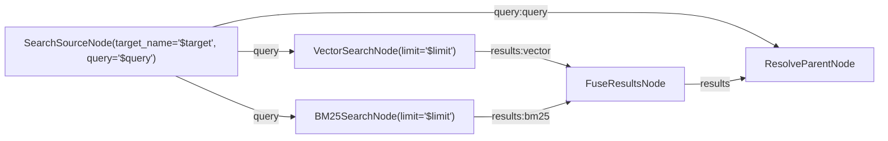

```rust
let (output, report) = runtime.execute_with_report(&mut graph).await?;
// report.nodes: name, status, duration_ms, output ports, metrics
// report.edges: from, to, value summary
```

## Search

Three signals, combinable as bitflags (`BM25`, `VECTOR`, `SPARSE`), fused by
reciprocal rank (or weighted), with each signal either feeding candidates or
boosting them. BM25 has six query modes — `Auto` (the default), `Contains`
(substring across tokens, fuzzy, relaxed separators), `ContainsSplit`, `Regex`,
`Parse` (boolean syntax), `Symbol` (exact, separators included: `foo->bar`,
`std::sync::Arc<Mutex<T>>`).

With `Auto`, a query goes to lucivy twice, in parallel: whole, as one substring
at distance 1, and word by word. What the whole query found is ranked ahead of
everything the fusion ranked, so a sentence copied from a file brings that file
back first. A long query is bounded and says so in `SearchMeta.warnings`: past
900 characters the whole query is searched without fuzziness, and the word
search keeps the 64 longest terms. lucivy treats `'` and `’` as the same
apostrophe since 4.3.2.

Each result says what each signal made of it — score and rank in that signal's
own list (`signals`), the signal that weighs most in its fused rank
(`bestSignal`), and the scale of its chunk's score (`chunk.signal`); the chunk
shown is the one from that signal. These scores are not comparable with each
other. Each chunk carries its highlighted passages (`highlights`, in UTF-16
units of the chunk text): the spans lucivy found, and, with
`options.highlights = "sparse"`, passages of a chunk found by the dense signal
alone, from the positions the bge-m3 service weighs (no tokenizer or model in
the host; the query words instead when the service does not answer). Engine
warnings come back in `SearchMeta.warnings` on every search; the `search_code`
tool also returns its metadata as JSON.

When a signal is unavailable or fails, the search falls back on the others and
says so in its status (`signal is not available` / `signal failed`) — never a
silent empty result. A vector index that is being rebuilt, missing or
incomplete makes the dense signal step aside, by name, while the words answer.
At the end of each index run, every full-text index counts its documents
against the rows and reports a gap. A filtered search reads all its signals
from the same committed state, and a filter applies to the learned-sparse
signal too.

When a dense or learned-sparse chunk points to several occurrences, search
returns every occurrence admitted by the request, with its own fields, file
positions and source attribution. Each occurrence keeps its best matching
score; ties have a stable order. Existing filters and cell selection still
apply. Content-addressed storage and layered worktree/branch views remain
under development; this projection does not enable them.

Full text is stored either **as files in `<base>.fts/`** (the default for a new
database on disk: lower memory, faster reopen; the folder is part of the database,
copy and back it up with it) or **in the database as blobs** (an existing database
that has them keeps them, and `RAG3WEAVER_FTS=blobs` asks for them). A database in
memory keeps its full text in itself.

The dense index prunes its HNSW graph with the classic heuristic since 10 October
2026 (engine `9a2818df9`): no row is left unreachable by its own vector, at +3 to 5 %
per query. **An existing index keeps its old graph** (the format does not change, only
the neighbour lists a write touches are rewritten); to get the new pruning, recreate it
(`DROP_VECTOR_INDEX`, then `CREATE_VECTOR_INDEX`).

## The code graph

With the `code` feature, a repository becomes a graph: files, scopes, symbols,
`DEFINES`, `CONSUMES`, `REFERENCES`, `MENTIONS` edges, with a `resolution` mark on each
edge saying how it was found (by path, by name, guessed). A C or C++ call is
resolved only to what its file includes. The synchronizer
indexes by batches, marks what it has proven, and on restart redoes only what is
incomplete. Tools built on it: `usages`, `impact` (what depends on this), links
rendered as a tree.

On a base with generations, a re-index keeps the history: a published row that changes is
closed, not rewritten, and its new row is born at the pending rank with the edges that pointed
to it; a removed file is retired, not erased. A file is skipped when both its content and the
analysis version (parser commit, `REGLES_DE_L_ANALYSE`, the code template) are unchanged, so a
re-index costs the diff. Raising `REGLES_DE_L_ANALYSE` makes every base re-analyse all its files
once at its next sync; `scripts/check_features.sh` refuses a change to the analysis that does not
raise it or say "sans effet sur l'analyse".

## The agent

rag3weaver is not a library an agent calls; it is where the agent runs.

- **The loop** (`agent.rs`): generate, execute the requested tools, feed the
  results back, start again — until the model answers or a bound bites. It is
  short because everything it assembles already exists.
- **Tools are nodes.** A tool definition for the model is generated from a
  node's schema (`tools.rs`): name, description, typed parameters. Nothing is
  written twice, and a tool call is a graph execution, with its report.
- **A backend is a manifest** (`backend.rs`): payload schemas and the graph
  tools it chooses to expose. No domain vocabulary in the engine; the code
  backend (`backend_code.rs`) declares its `workspace` — which files, under
  which root, read-only or not, with which command gate — so the same engine
  serves a cloud agent on a snapshot and a desktop agent on the real tree.
  When the root disappears from disk, `daemon_status` says « racine absente :
  <path> » and every tool that touches the files names the cause instead of
  returning a raw I/O error.
  A manifest can declare rendered entities with `derived.from` and `gather`.
  Omit `hashsafe` on a derived entity: the derivation defines its identity.
  Opening orders entities and relations by their dependencies; missing roots,
  invalid gather rules and dependency cycles are refused before any database call.
  A derived entity cannot itself be used as another derivation's `from`.
- **Sessions, postures, work domain** (`session.rs`, `postures.rs`,
  `work_domain.rs`): what is kept from one turn to the next and what stops
  being paid for; who stayed silent towards whom in a multi-party
  conversation; the dispersed set of repositories and notes an agent has in
  view.
- **Event-driven graphs** (`dataflow/reactor.rs`, `react_nodes.rs`): a graph
  declares what it reacts to on the bus (`each` / `batch` / `debounce`) and
  runs when it happens — the piece that lets a change in the data trigger
  work.
- **The model is a service**, like the embedder: `LlmNode`, a `decider`
  (a text, a closed list of options, a probability per option), an
  OpenAI-compatible client, the Anthropic Messages API (`anthropic-llm`,
  `"protocol": "anthropic"` in `models.llm`) or a local server, all behind the
  same `Llm` trait; streaming is in the trait, and a model may declare its
  reasoning budget (`models.llm.reasoning`). A refused call (429, 503) is
  retried after a minute, then twice as long each time, ten minutes and five
  retries at most; each backoff is written to the log and to the chat status
  with its number, code and wait. Each caller bounds its backoffs — a chat turn
  five minutes, a teammate step two, the judge ten — and past that the call
  fails, naming the cause and the time waited.

### Working alone: steps, a judge, a memory

An agent that works on its own is not one long turn. It writes a **mini-plan**,
does one item per **step**, declares the step done or failed, and is relaunched
with what arrived meanwhile. Every step is a **run** in the host's journal, and a
**judge** reads each run: one verdict on the session, one on every tool it
called. Both land in the memory as fiches, where the trend across runs is what
decides the next move. The supervisor (a person, or an orchestrating agent) only
ever writes to a mailbox.

The memory archivist can file document sections under cards with long names,
including judge reports. It preserves the exact card identity and refuses an
unknown or ambiguous candidate identifier.

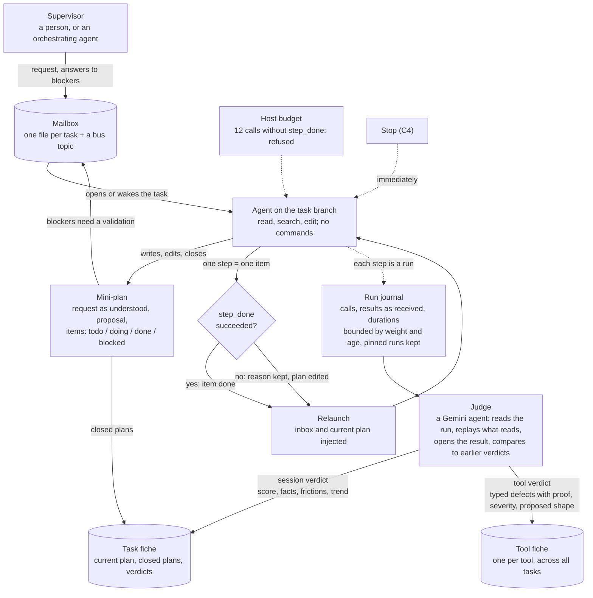

All of it is on master: the step loop, the mini-plan and the mailbox
(`0ab04909a`), the run journal and the session judge, the tool verdicts (missing
or misnamed parameter, a parameter that should be optional, a return that is
malformed, inconsistent, verbose, off-topic or incomplete, each with its call id
and a proposed shape, kept in a fiche per tool), and the journal bounded by
weight and age with pinned runs. Since then:

- **Each step starts a fresh thread**, carrying the request, the last 20 step
  results, the mailbox and the plan — a long task no longer drags its whole
  history into every call.
- **A question waits for its answer.** An unanswered question or approval
  suspends the teammate without calling the model; the mailbox says since when,
  and the step counts neither as done nor as failed.
- **Commands go through the gate.** In a task whose workspace declares a command
  gate, a command the gate holds becomes an approval in the mailbox; the
  workspace's declared scripts are pre-approved. The Landlock sandbox can run
  `cargo`, with a target shared per repository and the network closed.
- **A provider out of quota is waited for**, not counted as a failure: the same
  step is replayed after a growing delay, and the teammate stops after ten such
  steps, or at once on an exhausted daily quota. It resumes after a host
  restart, and a working teammate keeps the host from going idle.
- **A task ends only when it is done.** A step that says what remains is not
  the end, with or without a plan: the next step starts, and the mailbox says
  why. A request may declare what it expects before the end (`expects:
  "report"` or `"approval"`): without that report, or without the supervisor's
  approval, the task says it is done without the expected deliverable and waits
  for the mailbox.
- **Without its backend, it still reads and edits** the task's files, and says
  so; it stops after three failed steps in a row.
- **A task without git.** A task on a folder that no repository tracks opens
  in a copy of that folder, is reviewed by difference and merged back by copy,
  refused if the folder moved meanwhile. It writes in its copy when the
  workspace declares `task_writes`; `git_init` makes the folder a repository,
  only when declared.

The supervisor follows it at `/ide/teammate` (`/ide/teammate/mailbox`,
`/ide/teammate/pending`, `/ide/teammate/seen`, `/ide/teammate/list`), in the IDE
or in a terminal (below).

The binaries `rag3weaver-backend` and `rag3weaver-chat` are this runtime served
over HTTP, with sections rendered after each tool so that a person reading over
the agent's shoulder sees what it did. Every line of the host's log
(`daemon.log`) starts with its time to the millisecond and names the client,
session and repository of the call that wrote it. A second process that opens a
database for writing while another one holds it is refused with who holds it:
role, pid, since when, and the tool.

## The workshop

`rag3weaver-backend atelier` sets up a workshop: a chat whose space is the machine rather than a
branch of code. A new workshop takes the folder it is started from as its root, or `~/rw-code`
(created if missing) when started from the home folder or `/`; an existing workshop keeps its
root. In the chat, the workshop:

- attaches a worktree already on disk (`attach_worktree`), or opens a branch in a sibling worktree
  (`open_branch`, the git command it ran said in the answer); each is registered, opened and
  indexed in the background, and its progress and end show under the call and in the sidebar;
  `list_worktrees` gives each one's path, repository, branch, index and explicit context reference;
  nothing is cloned or pushed;
- searches and navigates an explicitly selected attached context with `search_code`, `grep_files`,
  `list_files`, `outline`, `navigate_symbols`, `usages`, `impact`, `callees` and `schema`. Pass the context returned by
  `list_worktrees` as `context: {target: {kind: "backend", id: "..."}}`, alongside the usual tool
  arguments (`query` and `options` for search, `path` for outline). Unknown or ambiguous targets,
  self-calls and unsupported views are refused; the runtime never selects the first repository;
- explores indexed structure with `navigate_symbols(path, mode, symbol, depth, limit, format)`:
  `file` shows a file root and indexed scopes, `parents`/`children` follow strict range inclusion,
  and `members` combines direct enclosed scopes with separately labelled declaration/property facts.
  `symbol` is a UUID or an exact name within the file/source; ambiguous names return candidates.
  Depth counts edges from the supplied root (0 keeps the root), with depth 16, 200 output items,
  2000 input scopes and 96 KiB caps. Ranges have line precision, not exact AST containment or inheritance;
  out-of-class methods and missing/untyped members remain explicit coverage limits. The tool checks
  the current source hash and withholds neighbors for stale or unverifiable indexed files.
  Use `format: "json"` for qualified references, provenance and limits; no code bodies are returned;
- follows a command's returned journal with `wait_output`, using the existing bounded journal reader;
- reads a file 200 lines at a time (`read_file`), or a scope from the index of an attached worktree
  by its name (`read_scope`); if a worktree lookup fails, the search reports itself as incomplete
  and preserves the error instead of claiming absence or uniqueness;
- writes with `replace_text` (an old text that appears exactly once), `replace_lines` and
  `insert_lines`; the line edits require that those lines were read in this turn or the previous
  one. Every write returns the unified diff, and a write inside an attached worktree reindexes it;
- writes a worktree it opened itself without asking; anything outside its root, and any worktree
  the user holds, goes through `ask_permission`: a card under the call, granted or refused by the
  user, and recorded one line per decision in `decisions.jsonl` next to the run journal;
- runs commands through its gate (`run_command`); a command the gate puts on hold shows the same
  card under the call, with the command line. A grant covers the complete exact line in the
  same working domain, including an explicitly approved outside path. Changed arguments,
  command chains or working domains need their own grant. Answering the same card twice
  does not publish an extra grant; a winning refusal stays refused. An outside script also needs
  read access declared in `workspace.sandbox.extra_read`, limited to that file;
  the command grant adds no sandbox rights. Without the declaration, the kernel can refuse
  the command and its error is returned. Grants bounded to one attempt are consumed when
  execution permits are issued, including under concurrent calls.
  The decision starts the next turn by itself: the model reads "granted: run it again" or
  "refused", and the user types nothing. A decision on a path card starts the turn again the
  same way.

## Claude Code and Codex

The memory and the mailbox reach agents that do not run in rag3weaver.

- **Hooks for Claude Code** (`rag3weaver-backend hook`, installed per session by
  `scripts/hooks_claude_code.sh`, never globally unless asked): at the start of
  a session, who you are and what you were holding; on each prompt, at most one
  related memory card, what others changed in the files you touched, the
  judge's last verdict on your task and the mailbox; after a compaction, the
  summary kept on the task card and an identity check; at about 70 % of the real
  context, a suggestion to tidy up. A recall that takes too long finishes in the
  background and shows at the next tool call, after a judge that can only
  remove candidates. A hook always exits 0 and is silent without a host. Its
  texts are templates (`templates/hooks/`).
- **A shared mailbox** (`rag3weaver-backend mail send|reply|pending|seen`):
  Claude Code sessions, Codex threads (`codex:<name>`) and teammates write to
  each other; a reply goes to the author of what it answers.
- **A channel** (`rag3weaver-backend canal`, an MCP server for Claude Code) that
  pushes mailbox items into a running session, with `reply`, `send` and `claim`.

## The IDE and the terminal

The host serves an IDE in React (`ui/ide/`, built into `templates/ide/app/` and
embedded, never loaded from elsewhere): the chat, files with in-page editing,
search, tasks and their review with the teammate, session verdicts, the tree,
symbols, the graph, the live DAG of a running tool (with a Stop button),
reactions and proposals. The chat keeps the order things happened in — words,
tool calls, the answer — during the turn and after a reload, each tool unfolded
with its time, duration and full result. If a later model call fails, completed tool calls
stay visible and a new message can resume the work. Turns started outside the form report
their actual failure or stop through the same event stream. A contextual tool result names its
repository; file and symbol links use the effective repository from its structured execution
receipt, including after a reload. A missing or unsupported context leaves those links inactive.
File references with a line range open at the first line. The sidebar speaks in repositories
(« Dépôts », « Mémoire », « Projets »), with a context gauge under each
conversation. Host state and completed chat turns arrive through the shared event stream:
an idle IDE sends no polling requests, and the sidebar's usage matches the chat state and
recap, including immediately after a turn. All tabs of a browser share one stream: a
`SharedWorker` holds the single `/ide/flux` connection, hands each tab the topics it asks for, and
carries a small shared state (current repository, selection, open conversation, pending cards)
that any tab reads and writes. Browsers open at most six HTTP/1.1 connections to a host, and six
tabs each holding their own stream used to leave none for requests. Without a `SharedWorker`, a tab
keeps its own stream; a page that leaves closes it. Search can be typed from the home page, across every index, and
the folder open in the tree filters it (the `scope` of `search_code`).
"My searches" lists the searches made in a repository,
by you and by agents under their name, with their first results and the ones you
clicked (`GET /ide/recherches`). Code in the chat is coloured by the same
tree-sitter grammars that index it (`POST /highlight`).

`rag3weaver-tty` (crate `tty/`, its own [README](tty/README.md)) follows a teammate from a terminal: the agent's
text scrolls into the terminal's own history and three lines are redrawn at the
bottom; Enter talks to the teammate, Esc or Ctrl-G stops it (Ctrl-G without the escape delay tmux adds). The input is a line editor like a shell's: arrows, Home and End, word jumps (Ctrl or Alt + arrow, Alt-B/F), Delete, Ctrl-W/U/K, ↑ and ↓ through what was sent, Alt-Enter for a new line, a paste arriving whole, Ctrl-C clearing the input before quitting, AltGr kept on Windows. The teammate's prose is in the terminal's own colour (or the theme's optional `couleurs.prose`) with common Markdown rendered (titles, bullets, bold, italic); mailbox headers keep the theme's accent, in French. It works over ssh (at most
30 redraws per second), resumes after a cut without loss or duplicate
(`Last-Event-ID`), degrades to 256 colours, 16, none and ASCII, and colours code
with the host's grammars and the theme `templates/themes/daemon.json`.
While the agent thinks, reads or writes, the view plays the Daemon Code
Summoning — runes, an alchemical symbol, a glitch — chosen by what the tool is
allowed to do, at most 1.6 KB/s over ssh. Four more themes share its form —
`--theme foret`, `cyberpunk`, `cyborg` or `alien` (or `RAG3WEAVER_TTY_THEME`), each a file of
`templates/themes/`, each held to the same minimal contrast against its background (4.5 for text
and readable code, 3 for what goes with it). What the teammate waits for comes first on the
status line: an approval shows its command, `o` grants it and `n` refuses it; a question is
answered by what you type (`answer` with `reply_to`); otherwise the teammate's state comes from
`GET /ide/teammate/list`. `--journal <file>` writes, as plain text, every line sent to the terminal's
history. Under mosh, which keeps no scrollback, a journal opens by itself in
`~/.local/state/rag3weaver/tty/` (journals older than seven days are removed), and the view shows the
command that reads it back (`less <journal>`). `--plain` writes the stream as text, and takes over by itself when the
inline view cannot start (a terminal that does not report its cursor position). Measured over ssh
both ways between two machines: about 47 ms from the host to the screen, 11 to 20 ms for a
keystroke's echo, 3 KB/s during a step (`tty/mesures/`, a scripted fake host and a pty harness).

## Embeddings and rerankers

All production models run on burn (wgpu/Vulkan — AMD, NVIDIA, Apple with one
implementation); candle stays as the parity oracle (`candle-embedder`), checked
bit for bit, not by a rounded cosine.

| Model | Dims | Use |
|---|---|---|
| granite-embedding-278m-multilingual | 768 | default |
| granite-embedding-107m-multilingual | 384 | first index of a large repository, or a weak GPU |
| all-MiniLM-L6-v2, paraphrase-multilingual-MiniLM-L12-v2 | 384 | light |
| BGE-M3 | 1024 | dense + learned sparse in one forward pass (`DualEmbedder`) |

Rerankers (`RerankNode`, `set_reranker`): ms-marco MiniLM, mmarco multilingual
MiniLM, bge-reranker-v2-m3. OCR (`ocr`, `burn-ocr`): PP-OCR on burn. Weights are
not bundled; they are published as `burnpack` files with upstream attribution
(see `generated/README.md`).

Any provider plugs in through traits: `Embedder`, `SparseEmbedder`,
`DualEmbedder`, `Reranker` (and their `Callback*` helpers). The core has no ML
dependency.

## Features

No feature is on by default.

| Feature | What it adds |
|---|---|
| `rag3db-native` | the rag3db connection (links the shared library built from the fork) |
| `postgres` | the PostgreSQL dialect and blob store |
| `burn-embedder` | the burn models on Vulkan (`burn-rocm` for ROCm) |
| `candle-embedder`, `bge-m3`, `cuda` | the candle reference models |
| `code` | the code graph (`codeparsers`, sandboxed file access) |
| `daemon` | the embedding daemon and service client |
| `openai-llm` | an OpenAI-compatible LLM client |
| `anthropic-llm` | the Anthropic Messages API client (implies `openai-llm`) |
| `navigateur` | the IDE's tests in a headless browser |
| `ocr`, `burn-ocr` | OCR |

Runtime knobs are `RAG3WEAVER_*` environment variables (about sixty; the ones
that matter for ingestion are `RAG3WEAVER_EMBED_MODEL`, `RAG3WEAVER_EMBED_SERVICE`,
`RAG3WEAVER_GPU_DUTY`, `RAG3WEAVER_EMBED_CHAR_BUDGET`, `RAG3WEAVER_FTS`,
`RAG3WEAVER_TX_PAR_PAQUET`, `RAG3WEAVER_BATCH_FILES`,
`RAG3WEAVER_TX_PAQUETS_PAR_VALIDATION`). They are documented where they are read.

## Tests

On Linux, the e2e and browser launchers share `scripts/confiner_validation.py`:
they acquire the workstation lock, require an effective memory cap of at most
32 GiB, and use a private session bus with no service activation. The launcher
records child identities, checks their cgroups, and stops only its own descendants.
Set `RAG3WEAVER_VALIDATION_TIMEOUT` to the lot's total budget (including cleanup).
For a composed pass, run `python3 scripts/confiner_validation.py lancer --delai 2400
-- bash /path/to/pass.sh`; nested launchers inherit the same supervised lifetime.
Evidence is kept outside the build target in `~/.cache/rag3weaver-build/validations/`.
The CPU-only tooling checks are `python3 scripts/test_confiner_validation.py`.


```bash
cargo test --lib --features "rag3db-native"        # unit tests
./run_e2e.sh                                        # end-to-end suites (131 e2e_*.rs files under tests/)
./run_e2e.sh --test e2e_code                        # one suite
```

End-to-end tests link the rag3db shared library (see `BUILD.md` at the root).
Several suites embed on the GPU; the ones that measure durability kill the
process with the database open and replay the journal.

## Where things are

```
src/
├── catalog.rs, catalog/        register, ingest, search; the batch synchronizer
├── search*.rs, fts_*.rs        signals, fusion, lucivy handle, FTS storage modes
├── dataflow/                   graph, runtime, ports, 47 nodes, Mermaid, reports, checkpoints
├── code*.rs, backend*.rs       code graph, agent backend and its tools
├── burn_*.rs, candle_*.rs      models
├── dialect.rs                  SchemaDialect: rag3db, PostgreSQL
├── scope.rs                    org × project
├── daemon_host/                the host: run journal, judge, chat, tasks, teammate, Codex delivery
└── bin/                        rag3weaver-backend, rag3weaver-chat, rag3daemon, rag3weaver-embeddings, rag3db-check-lib
templates/                      Mermaid pipelines, backends, hooks, the IDE bundle, themes
ui/ide/                         the IDE (React)
tty/                            rag3weaver-tty
scripts/                        hooks_claude_code.sh and other tools
codeparsers/                    submodule
docs/                           design notes and session reports (French), dated folders
visions/                        where this is going (French)
```

## License

[Luciform Research Source License (LRSL) v1.2](LICENSE)

The notebook and validated-result backend templates declare BGE-M3 (1024 dimensions)
without a fixed service address. Set `RAG3WEAVER_SERVICE_EMBED` for the host or tunnel
(the legacy `RAG3WEAVER_EMBED_SERVICE` is the fallback variable). An address explicitly
written in a manifest takes priority. Existing user copies are not migrated automatically.

`models.<capability>.activation` can explicitly start a provider through the shared
`Serveur` acquisition, for the dense, sparse, reranker and OCR capabilities. It checks the
provider's identity for that capability (the dense model and dimensions, the sparse model, the
reranker, the OCR) and its recipe, and isolates each caller's cancellation. Warm-up facts are reported separately from
availability. Existing sources without `activation` keep connecting to their configured
provider.

- **Residence.** With `residence: "maintenir"`, the provider is kept running: a call that finds it
  crashed starts it again, once, with its identity re-checked, and a failed restart is refused by
  name (declared `maintenir`, gone, restarted once, no answer: reopen or fix the declaration). With
  `residence: { "a_demande": { "inactivite_secs": N, "rendre_le_bail_secs": M } }`, it only
  starts on the first computation: opening the backend starts nothing, and neither does a
  full-text-only search. The client returns its usage lease after M seconds without a call. The
  provider unloads itself after N seconds without lease or call (M must be non-zero and shorter
  than N). The next index or dense search starts it again, once, with its identity re-checked.
- **Leases.** Each process that uses a provider holds a lease, renewed while it is in use. The
  provider counts its leases and calls in flight in `/sante` (`usage`), and says its eviction delay
  there (`eviction`). Providers started by hand never get an eviction delay. A provider started
  by an activation also says in `/sante` how many crash restarts its declaration has had
  (`relances`, counted in the declaration's coordination folder), so a provider that keeps dying
  shows without reading a log.
- **Named activations.** One provider process can serve several capabilities (bge-m3 with its
  sparse vectors, the bge-reranker-v2-m3 reranker and the ppocrv6-tiny OCR, for example). Declare
  it once at the top of the manifest, `activations: { "bge-m3": { "modele": "bge-m3", … } }`,
  and cite it by name from each declaration: `"activation": "bge-m3"`. `modele` is the model the
  process loads; the reranker and OCR it adds go in its `env` (`RAG3WEAVER_RERANK_MODEL`,
  `RAG3WEAVER_OCR_MODEL`). Declarations that cite the same name share one process, one
  coordination folder and one eviction: each capability holds its own lease, and the provider
  unloads when none is held. A cited name that is not declared is refused when the manifest
  loads. An activation block written inside a declaration is a named activation too, named after
  its `model`. A sparse declaration that states `dimensions` also yields a dual (dense and sparse
  in one call) on the same lease; the provider must then say `dual` at that dimension, and a
  sparse dimension that differs from the dense one is refused when the manifest loads. The recipe the provider attests is a hash of the name and the block.
- **Remote activation.** `hote` (an ssh target) and `adresse_distante` start the provider on
  another machine. The activation runs `ssh <host> systemd-run --user
  --unit=rag3weaver-fournisseur-<name>-<port> --collect --property=Restart=on-failure …` there,
  reaches it through an `ssh -N -L` tunnel held by the client, and probes its identity through the
  tunnel. A failing ssh is refused at once, by name. Units named `rag3weaver-embeddings@…` are
  never touched.
- **A service that stops says why.** If a computation panics on the card (a refused memory
  reservation, for example), the embedding service answers a named 503 instead of dropping the
  connection. It then answers every request still in flight, and exits with code 70; its last log
  line says « ✗ arrêt : <cause> (code 70) ». It never exits 0 silently. A text longer than
  `max_chars_per_text` (12000 by default, `RAG3WEAVER_EMBED_MAX_CHARS`, reported in `/sante` with
  `chars_per_token`) is cut to the cap, never refused with its batch: the client cuts it before
  sending and the index journal says how many texts were cut; the service also cuts for an older
  client, and counts it in `/sante` (`cut_texts`). A provider started by an
  activation that stopped this way is reported as « service d'embarquement arrêté : <cause> ».
- **Query length cap.** Before it is embedded (dense, dual or sparse), a search query is cut to
  `models.embed.query_max_chars` characters (6000 by default), on a word boundary. The search says
  so in its warnings, and full-text search keeps the whole query. A query of 8000 tokens asks the
  card for 4 GB of attention memory. A cap above `context_tokens − 2` is refused when the manifest
  loads: at worst one character is one token (accents, emoji, CJK, hex), plus two special tokens. The index state reports the value and whether it was declared or is the default.
- **Falling back to a service when the card is full.** An activation can state the memory its
  provider takes, `required_mib` (plus `margin_mib`, 2048 by default), and a minimum throughput,
  `min_throughput` (texts per second, over `window_secs`, 60 by default). The card it names in
  `peripherique` is measured before activating, by its free VRAM
  (`/sys/class/drm/<card>/device/mem_info_vram_*`, or the root given by `RAG3WEAVER_DRM_RACINE`).
  A card that does not read is never guessed: the activation runs unmeasured, and says so once.
  - **With `fallback: {"service": "127.0.0.1:7879"}`.** If the card is full, or the throughput
    drops below the threshold, the embedder serves through that service. The service must serve
    the declared model at the declared dimension, or it is refused by name. Its recipe is not
    checked, and the state says so. The provider on the card returns its lease.
  - **The return.** The fallback holds at least `fallback_hold_secs` (4 × `window_secs` by default).
    After that, it goes back to the card once the card has room, and says so.
  - **Without a fallback.** The activation runs anyway, and the state says « carte pleine, pas de
    repli déclaré ».
  - **With `fallback: {"activation": "<name>"}`.** The fallback is another named activation, on its
    own card, at its own `address` (required, port 0 allowed). It must be the same provider up to
    placement: only `peripherique`, `address` and the card variables of `env`
    (`RAG3WEAVER_BURN_DEVICE_*`, `*_VISIBLE_DEVICES`) may differ. Any other difference is refused
    when the manifest loads, by name. Its full recipe is attested when it starts, and the state says
    « recette vérifiée ». Its card is measured too, with its own `required_mib` (the primary's by
    default). If both cards are full, the primary activation runs, and the state reports both
    measurements. For example, a fallback on the integrated GPU sets `"peripherique": "card1"` and
    `"RAG3WEAVER_BURN_DEVICE_EMBEDDER": "igpu:0"`.
  - **Doubling the hold.** A fallback taken for throughput that comes back to the card, then drops
    below the threshold again in the next window, doubles its hold, up to
    `fallback_hold_max_factor` times (16 by default).

  Where this shows:
  - **The index journal**, after each pass, says where the vectors came from (« provenance des
    vecteurs : carte card2 : N morceau(x) ; service … : M morceau(x) »), and each fallback or return
    with its cause.
  - **The index state** carries it under `embedding.fallback`.

See the
[contract and qualification](https://github.com/L-Defraiteur/rag3db/blob/master/docs/embarquement/12-11-2026/03-activation-des-modeles.md).

`grep_files` accepte `symbol_hierarchy_depth` (0 par défaut : sortie et lectures
habituelles). Entre1et16, il ajoute le scope contenant le premier match regex
de chaque ligne, puis au plus ce nombre de parents de plages indexées. Les offsets
UTF-8, la source et le chemin qualifient la correspondance ; index absent/périmé
ou plages ambiguës restent explicites et les matches textuels sont conservés.
Le contenu déjà cherché sert au contrôle de fraîcheur, sans relecture ni réindexation.
Le budget de cette option est commun aux sorties JSON/Markdown :96Kio,200nœuds,
8fichiers ; une coupure conserve les comptes et se signale. Les relations de plages
à granularité ligne ne garantissent ni parent AST, ni appartenance, ni héritage.
