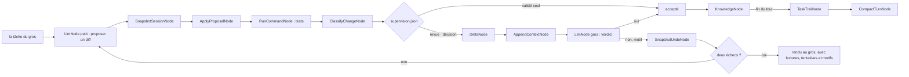

# Un gros modèle qui décide, un petit qui explore et écrit

28 novembre 2026, 11 h. Vision de Lucie (un rêve de la nuit, mûri au matin avec un autre assistant), mise en plan
concis avant tout code. Elle prolonge le ticket « Des mains locales pour le gros modèle » (27 novembre).

## L'idée

Le gros modèle prépare les tâches, arbitre et garde l'autorité sur l'architecture. Le petit modèle explore, implémente,
corrige et lance les tests. L'hôte tient ce que chacun connaît du code. Le gros ne reçoit que ce qui a changé, au moment
où il doit décider ; il peut refuser un diff, et le petit doit alors se corriger avant de continuer.

On ne synchronise pas les conversations des deux agents, mais **leur connaissance du code** : la mémoire du code est
reconstructible par l'index, seule l'interprétation reste au modèle.

## Ce qui existe déjà

- L'index : les scopes, leurs relations, leurs fichiers.
- La réécriture du contexte par paquets, qui ménage le cache ; la mise de côté des grosses sorties.
- L'atterrissage du tour : un commit par tour, donc le diff exact de chaque tâche.
- La porte et son juge, qui valident sans humain ; les nœuds d'instantané, qui annulent.
- La main d'édition sur un scope (ticket du 27 novembre) ; le nœud d'attente (ticket « L'hôte ne répond plus pendant un
  travail lourd ») ; la règle « Appris : … Ensuite : … » ; l'archiviste pour la mémoire longue.

## Ce qui est neuf

1. **Une proposition de modification, pas une écriture directe.** Le diff du petit est appliqué à titre provisoire (les
   tests doivent tourner sur le vrai état), annulé par l'instantané s'il est refusé ; le petit reçoit le motif, et ce
   qui dépend du diff attend le verdict.
2. **Un niveau de surveillance calculé par le code**, à partir de ce que le parseur sait :

   | Changement | Surveillance |
   |---|---|
   | le corps d'une fonction change, sa signature non, tests verts | validé seul |
   | une signature publique ou un symbole exporté change | revue du gros modèle |
   | un module neuf, une dépendance neuve (`Cargo.toml`, `package.json`) | décision du gros modèle |
   | deux échecs de suite | rendu au gros modèle |

   Le gros modèle peut durcir ces règles pour une tâche, quand il la prépare.
3. **Un registre de connaissance par agent**, tenu par l'hôte hors du contexte : pour chaque scope, la révision connue
   (une empreinte de son texte) et la forme (entier ou résumé). Il dit quoi **ajouter** au contexte, jamais quoi y
   réécrire.
4. **Le contexte du gros, en ajout seul pendant un tour.** Les lectures et diffs du petit attendent dans une file et ne
   sont ajoutés qu'aux points de décision (un diff à juger, une question). Scope inconnu : entier ou résumé. Scope connu :
   son diff seul. Scope inchangé : rien.
5. **La compaction en fin de tour, sans modèle.** L'hôte reconstruit, par l'index, la dernière version des scopes
   touchés et recommence un journal en ajout seul. Le cache n'est perdu qu'une fois par tour.
6. **Deux objets par tâche :**
   - **le résumé d'un scope** (ce qui existe) : versionné avec le scope, invalidé quand il change, réutilisable par
     toutes les sessions ;
   - **le cheminement d'une tâche** (pourquoi ça a changé) : l'hôte remplit les faits (scopes lus et modifiés,
     révisions avant et après, diff, tests) ; le petit n'écrit que l'interprétation (pourquoi, comment, pistes écartées,
     doutes).
7. **Rouvrir ce qui a été compacté** : `expand_task(id)`, `read_scope(id, révision)`, `get_task_diff(id)`,
   `compare_scope(id, de, à)`. Le gros peut reprendre la main sans refaire l'exploration, et la rendre au petit.

Trois mémoires, chacune avec son cycle de vie : celle du code (l'index, reconstructible), celle des modifications (les
cheminements), celle des décisions (le contexte du gros, compacté par tour).

## Tout en graphe, en briques minimales

Lucie, 28 novembre : « il faut que ce soit un graphe, encore une fois, que tout soit des briques minimales qu'on sache
réajuster, réordonner si ça ne nous plaît pas ». Rien de ce plan n'est un bloc de code fermé : chaque point est un nœud
ou une table déclarée, et la boucle est un gabarit qu'on modifie dans l'éditeur sans recompiler.

**Les briques** (✓ existe, ○ à faire) :

| Brique | Rôle |
|---|---|
| ✓ `LlmNode` à `response_schema` | le petit qui propose ; le gros qui juge ; le petit qui écrit le cheminement |
| ✓ `SnapshotSessionNode` / `SnapshotUndoNode` | poser l'instantané avant d'appliquer ; annuler un diff refusé |
| ✓ `RunCommandNode` | les tests du fichier touché |
| ✓ `Route`, `ConditionNode`, `ForEachNode` | aiguiller sur un verdict, une classe, un nombre d'échecs |
| ○ `ApplyProposalNode` | appliquer un diff à titre provisoire, rendre sa révision avant et après |
| ○ `ClassifyChangeNode` | dire, par le parseur, ce que le diff touche : corps, signature, export, module, dépendance |
| ○ table `supervision.json` | classe de changement → validé seul, revue, décision, rendu ; surchargeable par tâche |
| ○ `ListenNode` | attendre un verdict (le nœud d'attente) |
| ○ `KnowledgeNode` | lire et mettre à jour le registre de connaissance d'un agent |
| ○ `DeltaNode` | pour un scope et un agent : entier, résumé, diff ou rien |
| ○ `AppendContextNode` | ajouter à la fin du journal du gros, jamais au milieu |
| ○ `CompactTurnNode` | reconstruire par l'index la dernière version des scopes touchés, recommencer le journal |
| ○ `ScopeSummaryNode` | le résumé d'un scope, mis en cache par révision |
| ○ `TaskTrailNode` | assembler un cheminement : les faits par l'hôte, l'interprétation par le petit |
| ○ graphes-outils `expand_task`, `read_scope`, `get_task_diff`, `compare_scope` | rouvrir ce qui a été compacté |

**Le graphe par défaut** (`small_hand_turn.mmd`), une proposition à réordonner :

Changer la politique, c'est éditer la table ; tester avant ou après la classification, c'est déplacer un fil ; ajouter
un relecteur, c'est un nœud de plus devant le juge. Chaque brique a son témoin, par un vrai hôte, rouge d'abord.

## L'ordre, chaque étape mesurée

0. **Mesurer le gros modèle seul** sur le banc : coût par tâche, taux de cache, qualité. Sans cette base, on ne saura
   pas si l'architecture paie.
1. **La main d'édition** du ticket du 27 novembre, avec les propositions et la surveillance calculée : le gros ne voit
   plus que les diffs.
2. **Le registre**, la file de synchronisation, le contexte en ajout seul, la compaction de fin de tour.
3. **Les cheminements** de tâche et les outils pour rouvrir.
4. **Les règles de surveillance** posées par le gros à la préparation d'une tâche ; la reprise de la main dans les deux
   sens.

Chaque étape ajoute des briques du tableau ci-dessus et les branche dans le graphe par défaut.

## Ce qui dira que ça marche

À qualité égale sur le banc, le coût par tâche baisse nettement, et le cache du gros modèle reste au-dessus de 80 %
pendant un tour.

## Une réserve

Un petit modèle explore moins bien : le gros garde ses propres outils de lecture et peut aller voir lui-même. Le taux de
cache réel dépend aussi du fournisseur (sa durée de vie du cache, sa politique d'éviction) et du délai entre deux appels.
